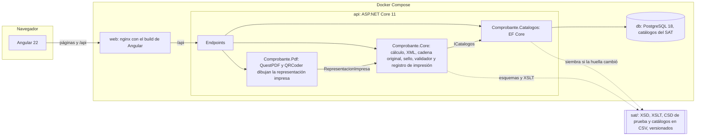

# Plan: generador y validador de XML CFDI 4.0 (sin timbrado)

Aplicación web y librería .NET para armar, sellar y validar comprobantes fiscales CFDI 4.0 sin timbrarlos. Calcula importes e impuestos con las reglas de redondeo del Anexo 20, genera el XML, lo sella con un certificado de prueba del SAT y revisa cualquier XML contra los esquemas y las reglas de validación del SAT, con el código de error de cada falla. Es un proyecto de portafolio: pequeño de mantener y pensado para mostrar dominio del estándar mexicano de facturación, buenas prácticas con .NET y Angular, y pruebas.

> **Nombre de trabajo: Comprobante** (el nodo raíz del CFDI). En tu sitio aparece como "Generador y validador de XML CFDI 4.0 (sin timbrado)". El nombre y el repositorio quedaron confirmados (sección 14).

> **Sin validez fiscal.** La app no timbra ni envía nada al SAT ni a un PAC: los XML que genera no son facturas válidas. Lo dicen la pantalla, el README y el nombre de los archivos descargados (`…-prueba.xml` y `…-prueba.pdf`) y la marca de agua del PDF.

Dónde vive cada cosa:

- **Este plan:** `PLAN.md`, en la raíz del repositorio. Nació en `C:\Users\rafik\Downloads\Claude\ProyectosPortafolio\Generador y validador de XML CFDI 4.0 (sin timbrado)`; esta copia es la que se mantiene al día.
- **Código:** `F:\Respaldo\Respaldo\Cursos\Comprobante`, junto a Mediateca.
- **Repositorio:** `https://github.com/RafaelLeonTorres/comprobante` (público).

---

## 1. Alcance

### Incluye (MVP)

- **Generar** CFDI 4.0 de ingreso y de egreso: emisor, receptor (incluido "público en general" con `InformacionGlobal`), conceptos con sus impuestos (IVA, IEPS, retenciones de ISR e IVA, exentos y tasa 0), descuentos, CFDI relacionados, moneda y tipo de cambio.
- **Calcular** importes, impuestos y totales con `decimal`, con los decimales de cada moneda y los límites de redondeo del Anexo 20.
- **Sellar** con los Certificados de Sello Digital (CSD) de prueba que publica el SAT: cadena original con el XSLT oficial y sello RSA con SHA-256.
- **Validar** cualquier XML CFDI 4.0: esquemas XSD del SAT, reglas de la matriz de errores (catálogos, cálculos y relaciones entre campos) y el sello contra su certificado. Cada falla trae su código del SAT (por ejemplo, `CFDI40161`), el nodo y un mensaje en español.
- **Catálogos del SAT** con la fecha de su versión, para las validaciones y para buscar claves: productos y servicios, unidades, códigos postales, usos de CFDI, regímenes, formas de pago, monedas, tasas o cuotas…
- **Ver** el XML formateado, la cadena original, el sello y los datos del certificado, y descargar el XML.
- **Descargar la representación impresa en PDF** (fase 6, hecha): una plantilla propia en hoja carta, con logo, emisor y receptor, conceptos, totales con letra, resumen de impuestos, sellos y, si el XML ya trae el timbre, el código QR de verificación del SAT. Un CFDI sin timbrar sale con la marca de agua «Sin validez fiscal».

### No incluye (extensiones posibles)

- Timbrado (PAC y Timbre Fiscal Digital), cancelación y consulta del estatus en el SAT.
- Validaciones que dependen de servicios del SAT: que el RFC exista y que su nombre, régimen y código postal coincidan con el padrón, o que el CSD esté vigente en la lista del SAT. La app revisa forma y consistencia, no existencia, y lo dice.
- Complementos: Pagos 2.0 (la extensión más útil), Carta Porte, Nómina y Comercio Exterior. Un XML con complementos se valida en su parte CFDI y los complementos aparecen como "no revisados".
- CFDI de retenciones y addendas.
- Firmar con el CSD propio del usuario en la app: una llave privada real no debe subir a un servidor. La librería sí lo permite para uso local (extensión: CLI).

---

## 2. Tecnologías

| Capa | Tecnología |
|---|---|
| Núcleo | .NET 11 (C# 15): `System.Xml` (`XmlWriter`, `XmlSchemaSet`, `XslCompiledTransform`) y `System.Security.Cryptography` (RSA, SHA-256, X.509). Sin dependencias externas |
| API | ASP.NET Core 11 con minimal APIs, OpenAPI y Scalar en desarrollo |
| Catálogos | PostgreSQL 18 con Entity Framework Core 11 (Npgsql): tablas, migraciones y búsqueda con índices `pg_trgm`. Los CSV versionados en el repositorio son la fuente y se cargan a la base al arrancar. Importador del Excel del SAT con ExcelDataReader |
| Frontend | Angular 22 (última 22.x), Angular Material, zoneless, Signal Forms y Vitest |
| PDF | QuestPDF 2026.9 (licencia Community 3.0) en un proyecto aparte, `Comprobante.Pdf`, con las fuentes Atkinson Hyperlegible (OFL) incrustadas, y QRCoder (MIT) para el código QR. Solo en pruebas: PdfPig y ZXing.Net, para leer el texto y el QR del PDF generado. Confirmado dentro de la imagen de Docker de la API: dibuja sin instalar ningún paquete nativo más |
| Pruebas | xUnit, WebApplicationFactory con Testcontainers (un PostgreSQL real y desechable) y archivos de referencia (XML y cadenas originales esperadas); Vitest en Angular |
| Infraestructura | Docker Compose con tres contenedores (nginx con Angular, la API y PostgreSQL) y GitHub Actions |

Notas:

- Mismas versiones que Mediateca: .NET 11 salió el 10 de noviembre de 2026 y Angular 22 es la vigente. La única base de datos es la de los catálogos del SAT, que la API solo lee: del comprobante que el usuario escribe o sube no se guarda nada.
- **Catálogos en PostgreSQL (decisión del 21 de noviembre de 2026).** El plan inicial los cargaba en memoria desde los CSV. Se cambió a una base de datos con EF Core para mostrar modelado, migraciones y consultas con índices. El costo es un contenedor más y una carga inicial de unos 14 segundos (151 346 filas) la primera vez que arranca.
- **CFDI 4.0 sigue siendo la única versión válida** (lo es desde el 1 de abril de 2023). En 2026 lo que cambió fueron la guía de llenado, los catálogos y algunas validaciones complementarias, no la estructura del XML.
- **Los catálogos cambian varias veces al año.** Por ejemplo, el 3 de septiembre de 2025 (productos y servicios, pedimentos y patentes aduanales) y el 2 de marzo de 2026 (pedimentos). Por eso la versión de los catálogos se ve en la app y actualizarlos es correr el importador.
- **XSLT 2.0 contra 1.0:** los XSLT del SAT se declaran como XSLT 2.0, pero usan funciones compatibles con 1.0, y otras librerías los procesan con motores 1.0. `XslCompiledTransform` implementa XSLT 1.0, así que las pruebas comparan las cadenas originales contra las que calcula aparte libxslt (lxml) con los mismos XSLT. Comprobado en la fase 2: coinciden en los cinco comprobantes de referencia (acentos, `&`, `Ñ`, retenciones, exentos, relacionados e información global). Si un XSLT nuevo usara funciones exclusivas de 2.0, el plan B es armar la cadena original en C#.

---

## 3. Arquitectura



Decisiones principales:

- **Sin estado del usuario.** La API procesa cada solicitud en memoria y no guarda ni registra el XML, porque un CFDI trae RFC, nombres y montos. La única base de datos guarda los catálogos del SAT y la API solo la lee.
- **Catálogos en PostgreSQL con EF Core.** Los 16 catálogos chicos se leen una vez y se guardan en memoria; los tres grandes (códigos postales, productos y servicios, y unidades) se consultan por clave, y la búsqueda de texto usa índices `pg_trgm`. La siembra es idempotente: compara la huella SHA-256 de los CSV con la de la última carga y, con un candado de PostgreSQL por si arrancan dos instancias a la vez, solo recarga si cambió.
- **Un núcleo sin paquetes de terceros.** `Comprobante.Core` define `ICatalogos` y no sabe de EF ni de PostgreSQL; se puede usar como librería (y publicar en NuGet). La API y la interfaz son capas delgadas encima. El cálculo vive solo en C#: Angular pide la vista previa de los totales a la API en lugar de duplicar las reglas.
- **Los archivos del SAT, versionados.** Los XSD (`cfdv40.xsd`, `catCFDI.xsd`, `tdCFDI.xsd`), el XSLT de la cadena original con sus `xsl:include`, los CSD de prueba y los catálogos viven en `sat/`, con la fecha en que se descargaron. Un `XmlResolver` propio traduce las direcciones `http://www.sat.gob.mx/sitio_internet/…` a esos archivos: nada se descarga en tiempo de ejecución y las pruebas son reproducibles.
- **Reglas con su código del SAT.** El validador es una lista de reglas pequeñas. Cada una tiene el código de la matriz de errores, el nodo que revisa y su mensaje en español, y se prueba por separado.
- **El generador pasa por el validador.** Todo lo que se genera se valida antes de entregarse; si aparece un hallazgo, la respuesta lo dice en lugar de presentar el XML como correcto.
- **El PDF en dos pasos.** `ConstructorDeRepresentacion` (en el núcleo) arma `RepresentacionImpresa`, un registro con todo lo que se imprime ya formateado, y `Comprobante.Pdf` solo lo dibuja. Así QuestPDF y QRCoder quedan fuera del núcleo y cada paso se prueba por separado.
- **Un solo origen**, como Mediateca: nginx sirve Angular y pasa `/api` a la API.

Estructura de carpetas:

```text
Comprobante/                            F:\Respaldo\Respaldo\Cursos\Comprobante (raíz del repositorio)
├── PLAN.md                             este plan
├── README.md                           qué hace, cómo levantarlo y cómo actualizar los archivos del SAT
├── docker-compose.yml                  web, api y db
├── .env.example                        puertos y contraseña de la base (distintos a los de Mediateca)
├── docs/                               banner y capturas del README (con el script que las toma) y el boceto de la plantilla del PDF (plantilla-pdf/)
├── sat/
│   ├── descargar.ps1, fuentes.json     de dónde sale cada archivo, cuándo se bajó y su huella
│   ├── origen/                         lo que baja descargar.ps1 (el Excel de catálogos, la matriz de errores y PDF); no va a git
│   ├── esquemas/                       cfdv40.xsd, catCFDI.xsd, tdCFDI.xsd y TimbreFiscalDigital
│   ├── xslt/                           cadenaoriginal_4_0.xslt y los XSLT que incluye
│   ├── csd-prueba/                     .cer, .key y emisores.json de los CSD de prueba del SAT (son públicos)
│   ├── catalogos/                      un CSV por catálogo y version.json con la fecha de publicación
│   └── matriz/                         matriz-errores.csv: las 129 reglas con su código y su mensaje
├── backend/
│   ├── Dockerfile
│   ├── Comprobante.slnx
│   ├── src/
│   │   ├── Comprobante.Core/           solicitud, cálculo y redondeo, XML, cadena original, sello, validador, reglas y el registro de impresión
│   │   ├── Comprobante.Catalogos/      EF Core: modelo, migraciones, siembra y consultas
│   │   ├── Comprobante.Herramientas/   importador del Excel del SAT (consola)
│   │   ├── Comprobante.Pdf/            la plantilla del PDF con QuestPDF, el código QR, las fuentes y el logo
│   │   └── Comprobante.Api/            endpoints, límites y OpenAPI
│   └── tests/
│       ├── Comprobante.UnitTests/      incluye Referencia/: XML sellados y cadenas originales hechos con Python, lxml y OpenSSL
│       └── Comprobante.IntegrationTests/   la API contra un PostgreSQL desechable (Testcontainers)
└── frontend/                           Angular 22
    ├── Dockerfile
    └── nginx.conf
```

---

## 4. Modelo

El comprobante no se guarda: su modelo son registros inmutables de C#. Lo único que vive en PostgreSQL son los catálogos del SAT (sección 7).

| Tipo | Contenido |
|---|---|
| `SolicitudCfdi` | Lo que llena el usuario, en JSON: Serie, Folio, Fecha, FormaPago, MetodoPago, CondicionesDePago, Moneda, TipoCambio, TipoDeComprobante, Exportacion, LugarExpedicion; Emisor, Receptor, InformacionGlobal, CfdiRelacionados y Conceptos. Se normaliza antes de calcular (mayúsculas, moneda MXN y tipo I por omisión, `ObjetoImp` inferido) |
| `Cfdi` y sus nodos | El comprobante tal como está en el XML, con todos los valores en texto: lo que escribe el generador y lee el validador (Version 4.0, y los nodos de abajo) |
| `Emisor` | Rfc, Nombre, RegimenFiscal, FacAtrAdquirente |
| `Receptor` | Rfc, Nombre, DomicilioFiscalReceptor, ResidenciaFiscal, NumRegIdTrib, RegimenFiscalReceptor, UsoCFDI |
| `Concepto` | ClaveProdServ, NoIdentificacion, Cantidad, ClaveUnidad, Unidad, Descripcion, ValorUnitario, Descuento, ObjetoImp, traslados y retenciones (Base, Impuesto, TipoFactor, TasaOCuota), ACuentaTerceros, InformacionAduanera y CuentaPredial |
| `ResultadoCalculo` | Importe e impuestos de cada concepto, impuestos agrupados por impuesto, tipo de factor y tasa o cuota, SubTotal, Descuento, totales de impuestos y Total, ya redondeados |
| `Hallazgo` | Código (del SAT o propio), severidad (error o advertencia), nodo, atributo, mensaje en español, y valor encontrado y esperado |
| `ReporteValidacion` | EsValido, hallazgos, cadena original, si el sello es válido y los datos del certificado (RFC, nombre, NoCertificado y vigencia) |
| `EmisorDePrueba` | RFC, nombre, régimen y código postal de un CSD de prueba, con su NoCertificado y vigencia. La llave y su contraseña no salen del servidor |

Detalles que vale la pena mostrar en el portafolio:

- **`decimal` siempre, nunca `double`.** Cada importe se calcula con hasta 6 decimales y se redondea al final, a los decimales de la moneda (`c_Moneda`), como recomienda el SAT. El importe de cada impuesto debe quedar entre un límite inferior y uno superior que el Anexo 20 calcula a partir de la base, la tasa y los decimales. El generador lo cumple y el validador lo revisa (por ejemplo, `CFDI40186` en retenciones). Las fórmulas son las del estándar técnico del Anexo 20 (DOF del 13 de enero de 2022), están en `Limites` y se prueban con los ejemplos de la guía de llenado. Los decimales cuentan como se escribieron: `1.50` tiene dos.
- **XML exacto:** prefijo `cfdi`, espacio de nombres `http://www.sat.gob.mx/cfd/4`, `xsi:schemaLocation` con la ruta oficial del esquema, atributos solo cuando tienen valor y números en formato invariable (punto decimal, sin separador de miles).
- **Exentos:** un traslado exento lleva Base, Impuesto y TipoFactor, sin TasaOCuota ni Importe.
- **Certificado:** `NoCertificado` sale del número de serie del CSD (el número de serie en hexadecimal codifica los 20 dígitos en ASCII) y `Certificado` es el `.cer` en Base64. La llave `.key` es PKCS#8 cifrada con contraseña y se lee con `RSA.ImportEncryptedPkcs8PrivateKey`, sin OpenSSL.

---

## 5. Generación y sello

1. **Entrada:** el comprobante llega en JSON. Primero se revisan los campos requeridos y las claves de catálogo; los errores vuelven por campo (`ValidationProblem`), en español.
2. **Cálculo:** importes por concepto, impuestos por concepto, resumen por impuesto, factor y tasa, y totales, con el redondeo y los límites de la sección 4.
3. **XML sin sello:** con `NoCertificado` y `Certificado` del emisor de prueba elegido.
4. **Cadena original:** se aplica el XSLT oficial del SAT con el resolver local.
5. **Sello:** firma RSA (PKCS#1 v1.5) con SHA-256 sobre los bytes UTF-8 de la cadena original, en Base64.
6. **Validación final:** el XML sellado pasa por el validador completo antes de entregarse.

La respuesta trae el XML, la cadena original, el sello, el cálculo y el reporte de validación. El archivo descargado se llama `{RFC}-{Serie}-{Folio}-prueba.xml` (con la fecha en lugar de la serie y el folio si no los hay; los caracteres que no son letras, números, guion o guion bajo, como el `&` de algunos RFC de prueba, pasan a guion bajo).

---

## 6. Validación

En este orden; si una capa falla de forma que impide seguir (XML mal formado, otra versión), el reporte se detiene ahí y lo explica:

1. **Lectura segura:** tamaño máximo, sin DTD ni entidades externas (contra XXE y bombas de entidades) y codificación UTF-8. Si no es un CFDI 4.0 (espacio de nombres o versión), lo dice en lugar de inundar el reporte de errores.
2. **Esquemas:** `cfdv40.xsd` con `catCFDI.xsd` y `tdCFDI.xsd`, más el del Timbre Fiscal Digital para aceptar XML ya timbrados. Los complementos sin esquema local se marcan como "no revisados".
3. **Reglas de la matriz de errores**, agrupadas:

   | Grupo | Ejemplos |
   |---|---|
   | Comprobante | `SubTotal` igual a la suma de importes; `Total` = SubTotal − Descuento + trasladados − retenidos; `MetodoPago` PPD exige `FormaPago` 99; `TipoCambio` de acuerdo con la moneda; `LugarExpedicion` en `c_CodigoPostal` |
   | Emisor y receptor | RFC con formato de persona física (13 caracteres) o moral (12); régimen que aplica al tipo de persona; `UsoCFDI` que corresponde al tipo de persona y al régimen del receptor (`CFDI40161`); público en general (`XAXX010101000`) con `InformacionGlobal`, régimen 616, uso S01 y domicilio igual a `LugarExpedicion`; `ResidenciaFiscal` cuando se registra `NumRegIdTrib` (`CFDI40153`) |
   | Conceptos | claves en `c_ClaveProdServ` y `c_ClaveUnidad`; `Importe` = Cantidad × ValorUnitario dentro de los límites; `ObjetoImp` 02 exige el nodo de impuestos |
   | Impuestos | `TasaOCuota` válida en `c_TasaOCuota` para el impuesto y el factor (valores fijos o rangos); exentos sin tasa ni importe; importes dentro de los límites; el resumen del comprobante coincide con la suma por impuesto, factor y tasa |
   | Sello y certificado | `Certificado` es un X.509 válido; `NoCertificado` coincide con su número de serie; la `Fecha` cae dentro de su vigencia; el sello verifica contra la cadena original con la llave pública |

4. **Advertencias** que no rechazaría un PAC pero conviene revisar, por ejemplo una `Fecha` en el futuro según la zona horaria del código postal de `LugarExpedicion` (el catálogo `c_CodigoPostal` la trae).

Los códigos y textos de cada regla se copian de la matriz de errores oficial del CFDI 4.0. Lo que no tiene código en la matriz (errores del XSD, advertencias) usa códigos propios con prefijo `CMP`: `CMP001` (XML ilegible), `CMP002` (no es un CFDI 4.0), `CMP003` (error del esquema), `CMP004` (complemento sin revisar, advertencia), `CMP005` (no se pudo calcular la cadena original, así que tampoco el sello), `CMP006` (hubo más de 300 hallazgos de reglas: se guardan los primeros y se cuenta el resto) y `CMP101` (fecha en el futuro, advertencia).

**Cobertura de la matriz.** La matriz trae 129 reglas. El validador revisa 103 completas y 5 en parte; las otras 21 no, porque necesitan datos que la app no tiene sin conexión: la lista de RFC inscritos (LRFC), el tipo de cambio oficial del DOF, la lista de contribuyentes obligados, los catálogos de aduanas y patentes, el límite del `Total` de la Resolución Miscelánea o lo que verifica el PAC al timbrar. Cada regla se publica con su estado y su motivo (`GET /api/validaciones/reglas`), así que ninguna se aprueba en silencio. Las cinco parciales:

- `CFDI40151` y `CFDI40154`: solo el RFC genérico extranjero (`XEXX010101000`) puede traer `ResidenciaFiscal` y `NumRegIdTrib`.
- `CFDI40164`: solo las claves que el catálogo marca con «Sí» para IVA o IEPS trasladado (el catálogo no trae retenciones por clave).
- `CFDI40189` y `CFDI40193`: solo con el RFC `EXT990101NI1` (nombre y domicilio).

`CFDI40209` tiene la misma condición que `CFDI40206` y se informa una sola vez, con ese código. Un error del esquema en el mismo nodo y atributo que una regla del SAT se descarta: queda el código de la matriz, que es el que explica qué corregir.

Un complemento que la app no trae en sus esquemas (Pagos, Nómina, Comercio Exterior...) no invalida el CFDI: el complemento queda sin revisar con una advertencia `CMP004`. Un CFDI ya timbrado se acepta porque el esquema del Timbre Fiscal Digital sí está cargado.

---

## 7. Catálogos

- **Fuente:** el Excel de catálogos del CFDI 4.0 que publica el SAT junto con el Anexo 20 (`catCFDI_V_4_20261120.xls`, que baja `sat/descargar.ps1` a `sat/origen/`).
- **Importador:** `Comprobante.Herramientas` lee el Excel con ExcelDataReader (también `.xls` antiguos), revisa lo que lee (claves repetidas, vigencias, columnas) y escribe un CSV por catálogo en `sat/catalogos/`, más `version.json` con el nombre del archivo y la fecha de publicación. Los CSV van a git: los cambios de una versión a otra se ven en el diff.
- **Base de datos:** `Comprobante.Catalogos` define las 19 tablas con la API fluida de EF Core (los tipos son clases planas de `Core`; nombres en `snake_case`) y las migraciones. Los CSV se incrustan en el ensamblado, así la API no necesita la carpeta `sat/` para sembrar.
- **Siembra:** al arrancar, la API aplica las migraciones y compara la huella SHA-256 de los CSV con la de la última carga (tabla `versiones_catalogos`). Si cambió, vacía y vuelve a llenar las tablas por lotes en una transacción, con `pg_advisory_xact_lock` para que dos instancias no se pisen; si no, no hace nada. La primera carga (151 346 filas) tarda unos 14 segundos.
- **Consulta:** los 16 catálogos chicos se leen una vez y se guardan en memoria (`CatalogosPequenos`) para que las reglas no vayan a la base; productos y servicios (52 513), unidades (2 418) y códigos postales (95 748) se consultan por clave. La búsqueda de texto usa `ILIKE` con índices GIN `pg_trgm`, y `%` y `_` se buscan como texto.
- **Relaciones** que usan las reglas: régimen fiscal y tipo de persona; uso de CFDI, tipo de persona y régimen del receptor; tasa o cuota, impuesto y factor; moneda y decimales; código postal, estado y zona horaria.
- **Visible:** `GET /api/catalogos` y la interfaz muestran la fecha de la versión. Una prueba de integración revisa que los 19 catálogos estén cargados y no vacíos, y que sembrar dos veces no duplique nada.

---

## 8. API

| Método y ruta | Para qué |
|---|---|
| `GET /api/health` | Saber si la API responde |
| `GET /api/emisores-prueba` | Emisores de los CSD de prueba del SAT: RFC, nombre, régimen y código postal |
| `POST /api/comprobantes/calculo` | Vista previa: recibe el comprobante en JSON y devuelve importes, impuestos y totales, con los errores de entrada por campo |
| `POST /api/comprobantes` | Genera y sella con el emisor de prueba elegido: `{ xml, cadenaOriginal, sello, noCertificado, calculo, validacion }` |
| `POST /api/validaciones` | Recibe el XML en el cuerpo (`application/xml` o `text/xml`, hasta 2 MB) y devuelve el reporte: `{ esValido, hallazgos, selloValido, cadenaOriginal, certificado }`. Un XML con errores es un 200 con sus hallazgos, no un error de la solicitud |
| `GET /api/validaciones/reglas` | Las 129 reglas de la matriz de errores y lo que la app hace con cada una (`revisada`, `parcial` o `noRevisada`, con su motivo) |
| `POST /api/representaciones/pdf` | Recibe en `multipart/form-data` el XML (`xml`, hasta 1 MB) y, si se quiere, un logo (`logo`, PNG o JPEG de hasta 200 KB y 2000 × 2000 px) y `incluirCadenaYSellos` (por omisión, sí). Devuelve la representación impresa en `application/pdf` (con `Cache-Control: no-store`), con el nombre `{RFC}-{Serie}-{Folio}-prueba.pdf` (sin `-prueba` si el XML trae timbre). Dibuja lo que dice el XML sin revisar sus reglas: para eso está `POST /api/validaciones` |
| `GET /api/catalogos` · `GET /api/catalogos/{nombre}?q=&pagina=&tamano=` | Versión y tamaño de los catálogos, y búsqueda paginada de claves |
| `GET /api/openapi/v1.json` · `GET /api/scalar` | La descripción OpenAPI y la página para probar la API |

- Errores con `ProblemDetails` en español: 400 con los errores por campo (en el PDF, `xml`, `logo` o `incluirCadenaYSellos`), 413 si el XML o el JSON pasan del límite (en el PDF, también el logo), 415 si no es XML (en el PDF, si no es un formulario `multipart/form-data`), 422 si el PDF no puede acomodar un comprobante (por ejemplo, con cifras de 32 dígitos) y 429, con `Retry-After`, si se excede el límite de solicitudes o si ya se están dibujando todos los PDF que se permiten a la vez.
- La API se documenta con OpenAPI y se explora con Scalar, también en producción: no tiene nada privado. Todo vive bajo `/api`, así nginx lo pasa con una sola regla.

---

## 9. Frontend (Angular 22)

| Ruta | Pantalla |
|---|---|
| `/` | Qué hace, el aviso de que no timbra, los tres caminos (generar, validar o consultar los catálogos) y el estado del servicio |
| `/generar` | Formulario por secciones (comprobante, emisor de prueba, receptor, conceptos con sus impuestos), con buscadores de catálogos y totales en vivo. Al generar: XML con resaltado, cadena original, sello, certificado, resultado de la validación y "Descargar XML" |
| `/validar` | Soltar o elegir un XML. Reporte con los hallazgos agrupados por nodo y con su código del SAT, la cadena original y el estado del sello |
| `/catalogos` | Buscador de claves y fecha de la versión de los catálogos |

Prácticas, las mismas que en Mediateca:

- Componentes standalone, signals, `@if` y `@for`, rutas con carga diferida y Angular Material (Material 3) con diseño adaptable y modo oscuro.
- **Signal Forms** en todos los formularios, con los conceptos como arreglo. Las reglas que se repiten (RFC, código postal) viven en un solo lugar.
- `httpResource` leído siempre con `hasValue()` antes de `value()`.
- **Ejemplos precargados:** ingreso con IVA y retenciones, venta a público en general, factura en dólares y egreso relacionado con un ingreso. Sirven para la demo y para las capturas.
- El visor de XML resalta la sintaxis con un componente propio, sin librerías pesadas.
- **Descargar PDF** (fase 6): un botón junto a «Descargar XML» en Generar y, en Validar, habilitado solo cuando el reporte no trae errores (un PDF bien presentado de un CFDI con errores engaña); apagado sigue siendo enfocable y dice por qué. Abre un cuadro con el logo del emisor (PNG o JPEG, con vista previa, su nombre y un botón para quitarlo: el tipo y el peso se revisan en el navegador y los demás errores, como un logo de 2500 × 100 px, los contesta la API y salen junto al logo) y la casilla «Incluir la cadena original y los sellos». Mientras se dibuja, el cuadro no se cierra y avisa; al terminar baja el archivo con el nombre que manda la API, devuelve el foco al botón y dice «Se descargó …». El logo y la casilla se recuerdan solo en memoria y solo después de una descarga que salió bien.

---

## 10. Seguridad

- **XML del usuario:** se lee con `DtdProcessing.Prohibit` y sin `XmlResolver`, contra XXE y bombas de entidades. El resolver local solo se usa para los archivos del SAT. El tamaño máximo se aplica en nginx y en la API.
- **Nada se guarda:** ni el XML ni los formularios se guardan o se registran. Los registros solo llevan tamaño, duración y resultado.
- **Solo CSD de prueba:** sus llaves y su contraseña son públicas, y la API nunca recibe llaves.
- **Límite de solicitudes** por IP y por minuto, con cubetas separadas para generar, validar, calcular y consultar, y una global (`Limites` en la configuración): al pasarse, 429 con `Retry-After`.
- **Cabeceras en nginx:** `Content-Security-Policy` en la app web, `X-Content-Type-Options`, `Referrer-Policy`, `X-Frame-Options`, `Permissions-Policy`, `Cross-Origin-Opener-Policy` y `Cross-Origin-Resource-Policy` en todo, `server_tokens off` y sin la cabecera `Server` de Kestrel.
- **PDF y logo (fase 6):** el PDF se dibuja solo con texto y números del XML leído con la lectura segura, sin HTML ni navegador de por medio, y se responde con `Cache-Control: no-store`. El XML pesa a lo más 1 MB (un CFDI normal ocupa unos cuantos KB y cada concepto de más son renglones y hojas de más). El logo es opcional y solo PNG o JPEG (nada de SVG), con el tipo comprobado por los primeros bytes y 200 KB y 2000 × 2000 px como máximo, leídos del encabezado antes de decodificar (contra las bombas de descompresión); no se guarda. Dibujar gasta procesador y memoria: hay una cubeta por IP (`Pdf`, 10 por minuto) y a lo más 4 PDF a la vez en toda la API (`PdfSimultaneos`); con todos los lugares ocupados la solicitud no espera en fila, recibe 429 con `Retry-After` y el cliente reintenta.
- **Sin cuentas ni sesiones:** no hay datos personales que proteger más allá de la solicitud en curso.

---

## 11. Pruebas

- **Unitarias (xUnit):**
  - cálculo y redondeo con muchos casos `[Theory]`: varios conceptos, descuentos, exentos, tasa 0, IEPS por cuota, retenciones y una moneda con otro número de decimales;
  - el XML generado contra archivos de referencia;
  - la cadena original contra las que calcula libxslt;
  - firma y verificación con los diez CSD de prueba, y el XML sellado idéntico byte por byte al que arma una implementación independiente (Python, lxml y OpenSSL; el sello PKCS#1 v1.5 es determinista);
  - cada regla con casos que pasan y que fallan;
  - el importador de catálogos con un Excel pequeño de ejemplo.
- **Integración (WebApplicationFactory):**
  - generar y luego validar ese XML: cero hallazgos;
  - un XML con errores sembrados devuelve sus códigos;
  - 413, 415, 429 y un XML con XXE rechazado;
  - los catálogos cargan en un PostgreSQL desechable (Testcontainers, necesita Docker) y la búsqueda responde.
- **Frontend (Vitest):** formulario de conceptos y totales, validador (archivo → reporte) y los servicios de la API.
- **PDF (fase 6):** el importe con letra con muchos casos; el armado de la representación con los cinco XML de referencia y uno con un timbre inventado; el PDF generado (su texto, leído con PdfPig, y su QR, leído con ZXing.Net, que devuelve la dirección del SAT con sus cinco parámetros); comprobantes extremos (1,500 conceptos, 3,000 CFDI relacionados, 500 impuestos en el resumen, un concepto con 300 impuestos, textos de mil caracteres sin espacios, cifras gigantes, caracteres que la fuente no tiene y un comprobante sin conceptos); valores que no son números en todos los importes y un comprobante al que se le quita, de a uno, cada atributo y cada nodo (unas 120 variantes, con y sin timbre), para que un XML raro no tumbe la solicitud; el validador del logo; la API (200, el nombre del archivo, 400, 413, 415, 422, un logo falso o enorme, la cubeta propia y el tope de PDF simultáneos con 429) y, en Vitest, el servicio, el botón y el cuadro de opciones.
- **CI (GitHub Actions):** compilar y probar el backend, probar y compilar Angular, y una prueba de humo que levanta los tres contenedores, consulta `/api/health` a través de nginx y comprueba sus cabeceras, el 413 y el 429.

---

## 12. Configuración

```jsonc
// appsettings.json: sin secretos (los CSD de prueba son públicos, y la base de desarrollo es local)
{
  "ConnectionStrings": {
    "Catalogos": "Host=localhost;Port=5435;Database=comprobante;Username=comprobante;Password=comprobante-dev"
  },
  "Catalogos": {
    "SembrarAlIniciar": true       // aplica migraciones y carga los catálogos si cambiaron
  },
  "Limites": {
    "JsonMaximoBytes": 1048576,    // 1 MiB: cálculo y generación (el XML a validar se limita a 2 MB, fijo, también en nginx; el del PDF, a 1 MB)
    "PdfSimultaneos": 4,           // PDF que se dibujan a la vez en toda la API (fase 6); con todos los lugares ocupados, 429
    "Solicitudes": {               // por IP y por minuto (fase 5)
      "Generar": 20,
      "Validar": 30,
      "Pdf": 10,                   // dibujar un PDF cuesta más que validar (fase 6)
      "Calcular": 240,             // los totales en vivo mandan hasta 2,5 por segundo
      "Consultar": 300,            // catálogos, emisores y reglas
      "Global": 600                // todo lo demás, salvo /api/health
    }
  }
}
```

- En Docker, los puertos y la contraseña de la base salen de `.env`: `WEB_PORT=8081`, `API_PORT=5081` y `DB_PORT=5435`, distintos a los de Mediateca para poder correr los dos proyectos a la vez. La API espera a que la base responda (`depends_on` con `service_healthy`) y su healthcheck da tiempo (`start_period`) a la primera carga de catálogos.
- Los archivos de `sat/` que usa la API (catálogos, esquemas, XSLT y CSD de prueba) viajan dentro de sus ensamblados como recursos: no hay rutas que configurar.
- Actualizar los archivos del SAT es un procedimiento documentado en el README: descargar, correr el importador (catálogos), correr las pruebas y hacer commit con la fecha de la versión. Al arrancar, la API detecta la nueva huella y recarga las tablas sola.

---

## 13. Fases

Cada fase entrega algo que funciona de punta a punta, con pruebas. Desde la fase 0 se trabaja con ramas y pull requests.

**Dónde vamos (22 de noviembre de 2026).** Hechas la fase 0 (backend, archivos del SAT, Angular, Docker Compose y CI; `docker compose up -d --build --wait` levanta los tres contenedores en unos 35 s con la base vacía), la fase 1 (importador, catálogos en PostgreSQL con EF Core, cálculo con los límites del Anexo 20 y `POST /api/comprobantes/calculo`), la fase 2 (XML, cadena original y sello: `POST /api/comprobantes` entrega el CFDI sellado con un CSD de prueba, que pasa el XSD y cuyo sello verifica) la fase 3 (el validador: `POST /api/validaciones` aplica el esquema, las reglas de la matriz de errores y el sello; 103 de las 129 reglas se revisan completas, 5 en parte y 21 no, con su motivo en `GET /api/validaciones/reglas`) y la fase 4 (Angular: desde el navegador se genera un CFDI con totales en vivo, se descarga, se valida con su reporte por nodo y se consultan los catálogos; probado a mano en escritorio, en una ventana de 782 px y en celular, en claro y oscuro). Van 571 pruebas unitarias y 94 de integración en el backend y 262 con Vitest en el frontend. La app tomó la identidad visual de mi sitio (morado, Atkinson Hyperlegible, tema claro u oscuro) y la fase 5 (seguridad y pulido) está hecha, salvo la prueba con un lector de pantalla: límites de solicitudes y de tamaño en la API y en nginx, cabeceras de seguridad con CSP y registros sin contenido, verificados con Docker y en el navegador. El README ya está, con su banner, sus capturas (las toma un script, `docs/capturas/tomar-capturas.mjs`), el estado, la seguridad y las cifras revisadas contra la API y el arranque en frío (33.7 s en total, 13.8 s para cargar los 151,346 registros de catálogos); al tomar las capturas apareció y se corrigió un desborde del número de certificado del emisor en Generar. Con la fase 6 se le agregó el PDF, sus capturas y la licencia de QuestPDF. La fase 6 (representación impresa en PDF, pedida el 22 de noviembre) quedó hecha: `POST /api/representaciones/pdf` dibuja el PDF con QuestPDF dentro de la imagen de Docker de la API, y Generar y Validar lo descargan desde un cuadro con logo opcional; igual que la interfaz, falta probarlo con un lector de pantalla. Lo siguiente: la fase 7 (cierre para el portafolio: artículo, proyecto en el sitio y demo).

### Fase 0. Base del proyecto
- [x] Confirmar las decisiones de la sección 14.
- [x] Crear la carpeta del código y copiar este `PLAN.md` a la raíz.
- [x] `.gitignore`, `.editorconfig` y licencia MIT.
- [x] Solución .NET 11 con `Core`, `Catalogos`, `Herramientas`, `Api` y los dos proyectos de pruebas, con la versión más reciente de cada paquete.
- [x] App de Angular 22 con Angular Material (Material 3, claro u oscuro según el sistema; fuentes e iconos sin servidores externos) y proxy hacia la API. La pantalla de inicio muestra el estado de la API y la versión de los catálogos.
- [x] Descargar a `sat/` los XSD, el XSLT de la cadena original con sus includes, los CSD de prueba, el Excel de catálogos y la matriz de errores, y anotar la fecha y la huella de cada uno (`sat/descargar.ps1` y `sat/fuentes.json`).
- [x] Docker Compose con `web`, `api` y `db`, healthchecks y puertos en `.env`.
- [x] Repositorio público.
- [x] GitHub Actions (`.github/workflows/ci.yml`: backend con Testcontainers, frontend y los tres contenedores). Se estrena con el primer push.

**Entregable:** `docker compose up -d --build --wait` levanta `web`, `api` y `db`, y la página muestra que la API responde.

### Fase 1. Catálogos y cálculo
- [x] Importador del Excel del SAT a CSV y `version.json`.
- [x] Catálogos en PostgreSQL con EF Core: modelo, migración, siembra idempotente, relaciones entre catálogos y búsqueda (`GET /api/catalogos`).
- [x] Modelo de la solicitud y cálculo de importes, impuestos y totales, con redondeo por moneda y límites.
- [x] `POST /api/comprobantes/calculo`.
- [x] Pruebas: muchos casos de cálculo, el importador y la API contra un PostgreSQL real. Medido: la primera carga de 151 346 filas tarda unos 14 s; con la base al día, el arranque no carga nada.

**Entregable:** la API calcula un comprobante con varios conceptos e impuestos, y los totales cuadran.

### Fase 2. XML, cadena original y sello
- [x] Escritor del XML con el orden y el formato del esquema (`EscritorCfdi`, con la declaración de espacios de nombres en el orden de los ejemplos del SAT).
- [x] Validación XSD con los esquemas locales (`ValidadorXsd`; el esquema de 6 MB se compila una vez y los mensajes salen en español, con el nodo, el atributo y la línea).
- [x] Cadena original con el XSLT del SAT y el resolver local, comparada contra la que calcula libxslt (`sat/` ya no lleva `ejemplos/`: las pruebas usan `backend/tests/Comprobante.UnitTests/Referencia/`).
- [x] Lectura del CSD (`.cer` y `.key`), `NoCertificado`, firma y verificación, con los diez certificados de prueba.
- [x] `POST /api/comprobantes` y `GET /api/emisores-prueba`.
- [x] Pruebas: 116 unitarias nuevas (CSD, cadena original, XSD, sello, zona horaria, nombre de archivo y cinco comprobantes idénticos byte por byte a los de la implementación independiente) y 8 de integración.

**Entregable:** un CFDI de ingreso sellado con un CSD de prueba pasa el XSD y su sello verifica.

### Fase 3. Validador
- [x] Lectura segura del XML: sin DTD ni resolver, tope de 2 MB (también con el cuerpo sin longitud) y versión. Los errores de XML mal formado salen en español, con la línea (`TraductorXml`, `CMP001`).
- [x] Motor de reglas y reporte (`MotorDeReglas`, `ContextoValidacion`: los catálogos que usan las reglas se consultan una vez por XML).
- [x] Reglas de comprobante, emisor y receptor, conceptos, impuestos, complementos, y sello y certificado, con sus códigos de la matriz: de las 129, 103 completas, 5 parciales y 21 no revisadas, cada una con su motivo (`ReglasSat`).
- [x] `POST /api/validaciones` (`application/xml` y `text/xml`, charset declarado o UTF-8 con BOM; 400, 413 y 415 como `ProblemDetails`) y `GET /api/validaciones/reglas`.
- [x] Pruebas por regla y XML de ejemplo con errores conocidos: un error sembrado para cada una de 104 reglas (109 casos, cada uno firmado de nuevo para que solo falle lo sembrado), la cobertura de las 129 reglas, 21 XML rotos explicados, los avisos de fecha y complementos, y todos los XML de referencia sin falsos positivos. 162 pruebas unitarias nuevas y 17 de integración.

**Entregable:** un XML con errores sembrados devuelve cada error con su código, nodo y mensaje.

### Fase 4. Angular: generar y validar
- [x] Generador con Signal Forms, buscadores de catálogos y totales en vivo; resultado con XML, cadena original, sello y descarga. Lleva el comprobante, el emisor de prueba, el receptor, la información global (público en general), los CFDI relacionados y los conceptos con sus impuestos; los errores de la API caen sobre el campo que corresponde y el foco pasa al aviso o al resultado.
- [x] Validador con arrastrar y soltar (también elegir o pegar el XML) y reporte por nodo, con el código de la matriz, lo encontrado y lo esperado, y un salto a la línea del XML. Incluye la tabla de las reglas que revisa y las que no.
- [x] Ejemplos precargados: cinco para generar (servicio con IVA, retenciones y descuento, dólares, público en general y egreso con relacionado) y dos para validar (uno sin errores y otro con cinco).
- [x] Pantalla de catálogos: los 19 catálogos con su número de filas, búsqueda por clave o descripción, paginación y una URL que se puede compartir (`?catalogo=…&q=…&pagina=…`).
- [x] Pruebas con Vitest (201 en 21 archivos) y revisión en el navegador, en escritorio (1280 px), en una ventana de 782 px y en celular (375 px), en claro y oscuro. La revisión encontró y corrigió: ayudas cortadas en los campos, un renglón de descuento vacío (la API omite los valores nulos), impuestos mal acomodados al apilarse, una línea larga de XML que ensanchaba la página, títulos de resultado mal redactados y el anillo de foco de Material, que viene apagado.

**Entregable:** desde el navegador se genera un CFDI, se descarga y, al volver a validarlo, no tiene hallazgos. Verificado con los cinco ejemplos contra la API real (la descarga, sin guardar el archivo: nombre, tipo, tamaño y sello) y con uno de ellos subido a la pantalla Validar.

### Fase 5. Seguridad y pulido
- [x] Límites de tamaño y de solicitudes, cabeceras de nginx y registros sin contenido.
- [x] Pruebas de integración de seguridad: XXE, 413, 415 y 429. La CI, además, levanta Docker y comprueba las cabeceras, el 413 y el 429 de nginx.
- [ ] Revisión de accesibilidad y del modo oscuro. Hecha en la fase 4 y repetida tras el cambio de estilo: contraste AA de todo el texto en las cuatro pantallas, en claro y oscuro (una auditoría calcula la razón de contraste de cada texto, también el del XML resaltado en las líneas con hallazgos); anillo de foco visible con el teclado; nombres accesibles, títulos sin saltos y regiones; celular de 375 px sin desbordes. Falta probar con un lector de pantalla, que tiene que hacer una persona.

**Lo que quedó.** Todo verificado, al cerrar la fase, con `dotnet test` (355 unitarias y 67 de integración), `ng test` (215), Docker y el navegador.

- **Configuración:** el bloque `Limites` de la sección 12. El límite del XML no se configura: lo fijan el lector del Core (`LectorXmlSeguro`) y el endpoint. El cálculo en vivo de Generar manda hasta 2,5 solicitudes por segundo (espera de 400 ms), por eso su cubeta es la más holgada, y cargar un ejemplo hace unas 20 consultas de catálogo.
- **Límite de solicitudes** (`Comprobante.Api/Seguridad/LimiteDeSolicitudes`): ventana deslizante de un minuto con 6 segmentos y sin cola, una política por cubeta (`.RequireRateLimiting(...)` en cálculo, generación, validación y en las consultas de catálogos, emisores y reglas) y un límite global que deja pasar `/api/health`. La clave es la IP (una IPv4 mapeada a IPv6 vale como la IPv4; una IPv6 se agrupa por su prefijo /64). Al rechazar: 429 con `ProblemDetails` en español, `Retry-After` con los segundos que faltan y un aviso en el registro con la ruta, sin la IP. Las opciones se leen con `IOptions` al atender la solicitud, porque `Program.cs` lee su configuración antes de que `WebApplicationFactory` la cambie.
- **Tope del cuerpo** (`LimiteDeCuerpoJson`): 413 para el JSON de cálculo y generación si pasa de `JsonMaximoBytes`; con `Content-Length` se decide sin leer nada y un cuerpo sin longitud se lee con tope. Kestrel queda de respaldo, con `MaxRequestBodySize` de 3 MiB y sin la cabecera `Server`.
- **Registros sin contenido** (`RegistroDeSolicitudes`): un renglón por solicitud con método, ruta sin la consulta, estado, duración y bytes recibidos; nunca el cuerpo, las cabeceras, la consulta ni la IP, y `/api/health` no se registra.
- **nginx** (`frontend/nginx.conf` y `frontend/nginx-cabeceras.conf`): `limit_req` de 20 solicitudes por segundo con ráfaga de 60 como freno previo a los límites finos de la API, `client_max_body_size` de 3 MB, y los 413 y 429 de nginx salen como `application/problem+json` en español (con `Retry-After` en el 429). Las cabeceras (`X-Content-Type-Options`, `Referrer-Policy`, `X-Frame-Options`, `Permissions-Policy`, `Cross-Origin-Opener-Policy` y `Cross-Origin-Resource-Policy`) viven en un archivo que se incluye en cada `location`, porque un `add_header` dentro de un `location` descarta los del `server`. La `Content-Security-Policy` (`default-src 'self'; script-src 'self'; style-src 'self' 'unsafe-inline'; img-src 'self' data:; font-src 'self'; connect-src 'self'; object-src 'none'; base-uri 'self'; form-action 'self'; frame-ancestors 'none'`) va solo en la app web, porque la página de Scalar necesita scripts en línea. La app solo se lee (`limit_except GET`); a la API se le pasa como `X-Forwarded-For` la IP que ve nginx (lo que mande el cliente se descarta); el registro de accesos no lleva IP, consulta ni agente de usuario, ni los healthchecks de Docker; y los tiempos de espera son cortos. Angular compila sin CSS crítico en línea (`optimization.styles.inlineCritical`): su `<link onload>` lo bloquearía la CSP.
- **Pruebas:** `ApiFactory` con límites altos y `FORWARDEDHEADERS_ENABLED`; `SeguridadApiTests` con `WithWebHostBuilder` y límites bajos (429 con `Retry-After`, cuotas independientes por IP y por cubeta, IPv6 por /64, `/api/health` sin límite, 413 del JSON con y sin longitud, y que el registro no lleve contenido), `ClaveDeClienteTests` y, en el frontend, los textos del 429 y del 413 de nginx y de la API en `aErrorApi` y en los totales en vivo.
- **Verificado a mano con Docker:** una ráfaga de 150 solicitudes dio 68 respuestas normales y 82 con 429 de nginx (`application/problem+json`, `Retry-After: 1`); contra la API directa, 429 con los segundos que faltan; 4 MB de cuerpo, 413 de nginx; 2,5 MB, 413 de la API; el registro de nginx y el de la API no traen IP ni consulta; la pantalla muestra el aviso del 429; y las cuatro pantallas cargan sin violaciones de la CSP (la consola sí registra las que se provocan a propósito).
- **De paso:** las opciones de los campos de Material pasaron de `app.config.ts` a las páginas con formularios y el paquete inicial bajó de 570 a 431 kB (Angular Forms ya no se carga en la portada).

**Entregable:** las pruebas de seguridad pasan en la CI y la app se usa con teclado y lector de pantalla (esto último, pendiente).

### Fase 6. Representación impresa en PDF
Pedida el 22 de noviembre de 2026: además del XML, la app debe dejar **descargar la representación visual del CFDI**, el PDF. El dueño del proyecto pasó un ejemplo (el CFDI 3.3 de un banco: una hoja carta hecha con Microsoft Reporting Services, con logo, folio fiscal, emisor y receptor, conceptos, totales con letra, resumen de impuestos, datos del timbre, QR y sellos) para que la plantilla siga esa estructura. La plantilla es propia, con el logo de Comprobante y un lugar para el del emisor. Ni la marca ni los datos del ejemplo entran al repositorio: es la factura de un tercero.

**Hecha el 22 de noviembre.** `docs/plantilla-pdf/` conserva el boceto del que partió el PDF: el logo (`logo.svg`) y dos hojas de ejemplo, una de un CFDI sin timbrar y otra de uno timbrado, con datos de prueba del SAT; su `LEEME.md` da las medidas y las reglas del diseño. El PDF real lo sigue, con las diferencias que se anotan en «Lo que cambió al programarla».

La plantilla, de arriba abajo (hoja carta, márgenes de 12 mm, la identidad de la app: tinta, líneas suaves y el morado `#512bd4` en el título, las secciones y el total, con un tinte claro en los encabezados de tabla para que imprima bien):

1. **Encabezado.** Caja del logo de 60 × 20 mm (el del proyecto por omisión, o el del emisor), el título según el tipo de comprobante (FACTURA para ingreso y NOTA DE CRÉDITO para egreso) y, a la derecha, dos cuadros: **Folio fiscal (UUID)** y **Serie-Folio** con la **Versión** (4.0).
2. **Emisor y receptor.** Del emisor: nombre, RFC, régimen fiscal (clave y descripción) y lugar de expedición. Del receptor: nombre, RFC, uso del CFDI, régimen fiscal y domicilio fiscal, y residencia fiscal y número de registro tributario cuando vienen. El ejemplo es de 3.3: en 4.0 se agregan el régimen y el domicilio del receptor y la exportación.
3. **Datos del comprobante.** Fecha y hora de emisión, tipo de comprobante, exportación, moneda, tipo de cambio, forma y método de pago, condiciones de pago e información global y CFDI relacionados (tipo de relación y UUID), cuando existen. Con timbre, también el número de serie del certificado del SAT, la fecha y hora de certificación y el RFC del proveedor de certificación.
4. **Conceptos.** Tabla con clave de producto o servicio, unidad, cantidad, descripción (con el número de identificación), valor unitario, descuento, objeto de impuesto e importe; debajo de cada concepto, en letra chica, sus impuestos, uno por renglón. El encabezado se repite en cada página y ningún concepto se parte entre dos, salvo uno que se estima de más de 150 mm de alto (una descripción de mil caracteres con decenas de impuestos): ese se deja partir, porque pedirle a QuestPDF que mantuviera entero algo más alto que una hoja haría que fallara.
5. **Totales.** Subtotal, descuento, impuestos trasladados, impuestos retenidos y total (con la sombra sólida de la tarjeta «registro» del sitio), y el **importe con letra** («DIEZ MIL SETECIENTOS OCHO PESOS 48/100 M.N.»).
6. **Resumen de impuestos.** Trasladados (base, impuesto, tipo de factor, tasa o cuota e importe) y retenidos.
7. **Sellos.** El código QR, la cadena original del complemento de certificación del SAT, el sello digital del emisor y el sello digital del SAT, en letra chica monoespaciada que se corta donde caiga (el Base64 no tiene espacios). Bajo el QR va un enlace al mismo verificador, para quien no pueda escanearlo.
8. **Pie.** La leyenda «Este documento es una representación impresa de un CFDI», «Generado con Comprobante» y «Página X de Y».

**Sin timbre y con timbre.** Lo que la app genera no está timbrado: no tiene UUID, certificado ni sello del SAT, y tampoco QR (el del SAT se arma con el UUID, así que no puede existir). Ese PDF lleva una franja «Comprobante de prueba · no timbrado · sin validez fiscal» arriba, una marca de agua diagonal «Sin validez fiscal» en cada página, «Sin timbrar» en el cuadro del folio fiscal y un recuadro «Sin timbre» donde iría el QR; sus sellos son la cadena original del comprobante y el sello del emisor. Un XML que ya trae el complemento `TimbreFiscalDigital` (se puede subir a Validar) sale completo y sin marca de agua. Como la app no verifica el timbre contra el SAT, el PDF no afirma validez: representa el XML, y el QR deja que quien lo reciba lo verifique en el portal del SAT.

**El código QR** sigue el Anexo 20 (rubro I.E, igual para 3.3 y 4.0): la dirección `https://verificacfdi.facturaelectronica.sat.gob.mx/default.aspx` con `id` (el UUID), `re` (RFC del emisor), `rr` (RFC del receptor), `tt` (el total a 17 posiciones: 10 enteros, el punto y 6 decimales, por ejemplo `0000014300.000000`) y `fe` (los últimos 8 caracteres del sello del emisor). La cadena original del complemento de certificación se arma con el XSLT del timbre, `cadenaoriginal_TFD_1_1.xslt`, que ya está en `sat/xslt/`. En la fase se contrastó con guías que citan el Anexo 20 (el PDF oficial no se pudo abrir desde donde se trabajó): nivel de corrección de errores M como mínimo y los parámetros `id`, `re`, `rr`, `tt` y `fe`, en ese orden. El QR sale en vector, de 30 mm de lado (medido en el PDF) con 3 mm de zona de silencio por lado; esas guías dan 2.75 cm como tamaño mínimo impreso, un dato que queda por confirmar contra el texto oficial.

**Lo que cambió al programarla** (frente al boceto):

- Los rótulos y los encabezados de las tablas van en minúsculas y no en mayúsculas sostenidas: se leen mejor y algunos lectores de pantalla deletrean las palabras en mayúsculas. El título (FACTURA, NOTA DE CRÉDITO) sí va en mayúsculas.
- La letra es Atkinson Hyperlegible Next y Mono, incrustadas, en lugar de Inter y DejaVu Sans Mono, que eran las que había a la mano para el boceto.
- Las columnas de cifras de la tabla de conceptos miden lo que sus importes necesitan y lo que sobra es de la descripción; con importes enormes la letra se achica, hasta 5.5 pt, antes de dejar a la descripción en una tira donde cabe una letra por renglón. El total también se achica cuando tiene ocho dígitos o más.
- Los impuestos de cada concepto van uno por renglón. El encabezado de la tabla se repite en cada hoja y, desde la segunda, hay un encabezado compacto que dice de qué comprobante es.
- Con timbre, bajo el QR va un enlace al verificador del SAT (el boceto solo traía el texto).
- El PDF va etiquetado para que un lector de pantalla lo recorra en orden (título, emisor y receptor, datos, conceptos, totales y sellos); lo decorativo (marca de agua, franja de prueba, encabezado compacto y pie) va como artefacto. Lleva idioma `es-MX`, título y asunto, que sin timbre dicen que es de prueba y sin validez fiscal. No se pasó por un verificador de PDF/UA ni se probó con un lector de pantalla.
- La única opción del formulario es `incluirCadenaYSellos`; el plan hablaba de un campo genérico `opciones`.

**Decisiones tomadas:**

- **Biblioteca: QuestPDF 2026.9**, en un proyecto nuevo, `Comprobante.Pdf` (el núcleo sigue sin paquetes de terceros). Dibuja con código tablas que se parten en páginas con el encabezado repetido, pie con «Página X de Y», marca de agua y texto que corta las cadenas largas, no necesita un navegador sin cabeza y etiqueta el PDF para accesibilidad. Se confirmó dentro de la imagen de Docker de la API (Debian, sin privilegios): dibuja sin instalar ningún paquete nativo más (la imagen sigue con solo `curl` y `tzdata`), así que `SkiaSharp.NativeAssets.Linux.NoDependencies` no hizo falta y el plan B, PDFsharp y MigraDoc (MIT), quedó sin usar. Su licencia Community 3.0 (vigente desde el 6 de julio de 2026) es gratuita para individuos, para proyectos de código abierto con una licencia aprobada por la OSI (este es MIT) y para negocios con ingresos anuales menores a un millón de dólares; el sector público y las empresas que cotizan en bolsa no califican, aunque ganen menos. No es una licencia de código abierto (la propia QuestPDF la describe como comercial, con el código a la vista), y el README lo dice.
- **QR:** QRCoder 1.9 (MIT), dibujado en vector (SVG) con nivel de corrección M. En las pruebas, PdfPig lee el texto del PDF y ZXing.Net lee el QR.
- **Tipografía:** Atkinson Hyperlegible Next y Mono (OFL, las del sitio y la app) en TTF incrustados en el ensamblado, con `UseSystemFonts = false`: el PDF sale igual en Windows, Linux y el contenedor, y cada PDF lleva solo los glifos que usa. Cubren latín, griego y cirílico; un carácter que no tienen (un emoji, un ideograma, el árabe) sale como un cuadrito en lugar de detener la generación. Las licencias están junto a las fuentes, en `backend/src/Comprobante.Pdf/Fuentes/`.
- **Del XML al PDF en dos pasos**, para probar cada uno por separado: `ConstructorDeRepresentacion` (en `Comprobante.Core`, con `ICatalogos`) arma `RepresentacionImpresa`, un registro con todo lo que se imprime ya formateado (descripciones de las claves, importes con su moneda, importe con letra, dirección del QR y cadena del complemento), y `Comprobante.Pdf` solo dibuja ese registro. Lo que el XML trae mal (un importe que no es número, una clave que no está en el catálogo, un atributo que falta) se imprime como viene o se omite: el PDF dibuja el XML, no lo valida.
- **API:** `POST /api/representaciones/pdf` (sección 8), con tres frenos propios: el XML de 1 MB como máximo (la mitad de lo que se puede validar: cada concepto de más son renglones y hojas de más), una cubeta por IP en `Limites:Solicitudes` (`Pdf`, 10 por minuto: dibujar cuesta más que validar) y `Limites:PdfSimultaneos` (4 PDF a la vez en toda la API, sin fila: con todos los lugares ocupados, 429 con `Retry-After: 3`). Responde 400, 413, 415, 422 y 429 como `ProblemDetails`, y el PDF con `Cache-Control: no-store`. Si QuestPDF no puede acomodar el comprobante (`DocumentLayoutException`), `GeneradorPdf` lo convierte en `PdfNoGenerableException` y la API contesta 422.
- **Logo del emisor:** solo PNG o JPEG, con las comprobaciones de la sección 10, hechas en dos tiempos: lo barato (peso, tipo y tamaño en píxeles, leídos del encabezado) antes de tomar un lugar para dibujar, y que el motor logre abrir la imagen ya con el lugar tomado. No se guarda: viaja en la solicitud y se descarta. Sin logo, sale el del proyecto.
- **Cuándo se ofrece:** «Descargar PDF» va junto a «Descargar XML» en Generar (el XML recién sellado ya pasó el validador) y, en Validar, solo si el reporte no trae errores y el XML no pasa de 1 MB; apagado, dice por qué.
- **El PDF en sí:** hoja carta, idioma `es-MX`, título («Factura H-2026-0042») y asunto en los metadatos, y el nombre de archivo `RFC-Serie-Folio-prueba.pdf` (sin serie ni folio, el UUID o la fecha; sin `-prueba` si ya está timbrado).

- [x] Boceto de la plantilla con el logo de Comprobante en `docs/plantilla-pdf/`, para aprobar el diseño antes de programar.
- [x] Confirmar la biblioteca: QuestPDF dibuja un PDF dentro del contenedor de la API sin instalar nada más; el plan B no hizo falta.
- [x] `ImporteConLetra` en `Comprobante.Core` (pesos y otras monedas, «UN MILLÓN DE PESOS…», «CIEN» y «CIENTO UN», centavos redondeados).
- [x] `RepresentacionImpresa` y `ConstructorDeRepresentacion`: del CFDI leído y de los catálogos al registro de impresión, con la dirección del QR y la cadena del complemento; con `TimbreFiscalDigital` toma sus datos y sin él arma el modo «sin timbre».
- [x] `Comprobante.Pdf`: la plantilla (encabezado, emisor y receptor, datos, conceptos con encabezado repetido, totales, resumen de impuestos, sellos y pie), el QR, la marca de agua y las fuentes incrustadas.
- [x] `POST /api/representaciones/pdf` con sus límites, la cubeta `Pdf`, el tope de 4 PDF a la vez y la validación del logo.
- [x] Angular: «Descargar PDF» en Generar y en Validar, con el cuadro de opciones (logo con vista previa y cadena original) y el manejo de errores.
- [x] Pruebas (sección 11): importe con letra, constructor, texto y QR del PDF, comprobantes extremos, la API y Vitest.
- [x] Revisión a ojo: los PDF de los cinco ejemplos con y sin timbre, con logo PNG y JPEG, sin sellos y con 70 conceptos (10 hojas sin timbre y 8 con él, con el encabezado de la tabla repetido y, desde la segunda hoja, el compacto), vistos hoja por hoja como imagen; el tamaño de hoja es carta (612 × 792 pt). No se imprimieron en papel.
- [x] Prueba de humo en la CI: pedir un PDF a la API en Docker, a través de nginx, y comprobar que empieza con `%PDF-`, que es `application/pdf` y `attachment`, que no se guarda en caché y que un logo de 300 KB y un XML que no es CFDI se rechazan con 400.
- [ ] Probar el cuadro de «Descargar PDF» y los PDF con un lector de pantalla (lo tiene que hacer una persona).

**Verificado** con `dotnet test` (571 unitarias y 94 de integración; una prueba más, la que escribe los PDF de muestra para revisarlos a ojo, solo corre si se define `MUESTRAS_PDF`), `ng test` (262) y `ng build` (paquete inicial de 441 kB), con la prueba de humo de la CI corrida en local contra Docker y en el navegador, con la app real: en Validar, «Un CFDI sin errores» → «Descargar PDF» abre el cuadro (con el foco en «Elegir logo»), baja `WATM640917J45-H-2026-0042-prueba.pdf` (109 KB, empieza con `%PDF-`), lo cierra, devuelve el foco al botón y dice «Se descargó …»; con un logo de 300 × 100 px baja otro PDF (110 KB con el logo de prueba); con uno de 2500 × 100 px, el cuadro sigue abierto y muestra el mensaje del servidor junto al logo («El logo mide 2500 × 100 px; el máximo es 2000 × 2000 px.»); el cuadro se ve bien en claro y oscuro.

**Entregable:** desde Generar se descarga el PDF de un CFDI recién sellado, con su marca de «sin validez fiscal», y desde Validar el de un XML con timbre de ejemplo, con un QR que lleva al verificador del SAT; los dos se ven bien en las hojas que se revisaron como imagen.

### Fase 7. Cierre para el portafolio
- [x] README con descripción, capturas, diagrama, decisiones técnicas y cómo actualizar los archivos del SAT (con la función del PDF, la licencia de QuestPDF y sus capturas).
- [ ] Artículo en el sitio, en `_posts/es` y `_posts/en`, con `repo` en el front matter.
- [ ] En `_data/projects.yml`, agregar al proyecto `url`, `status: done` y `post`.
- [ ] Decidir si hay demo pública (sección 14).

**Entregable:** el proyecto aparece terminado en el sitio, con su artículo y el enlace al código.

### Extensiones (después del MVP)
- [ ] Complemento de Pagos 2.0: generar y validar.
- [ ] CLI: `comprobante validar factura.xml` y `comprobante sellar` con un CSD propio, en la computadora del usuario.
- [ ] Publicar `Comprobante.Core` en NuGet.
- [ ] Validar el RFC con la librería del proyecto "Validador de CURP y RFC".

---

## 14. Decisiones

Confirmadas el 21 de noviembre de 2026:

1. **Nombre y repositorio:** Comprobante, en `RafaelLeonTorres/comprobante`. Es corto, en español y no usa la marca de nadie.
2. **Carpeta del código:** `F:\Respaldo\Respaldo\Cursos\Comprobante`, junto a Mediateca.
3. **Tipos de comprobante del MVP:** ingreso y egreso. Traslado y pagos (con el complemento 2.0) quedan como extensión.
4. **Firma:** en la app, solo con los CSD de prueba del SAT. El CSD propio, solo en la CLI y en la computadora del usuario.
5. **Catálogos:** PostgreSQL con EF Core, a petición del dueño del proyecto, en lugar de CSV en memoria. Los CSV siguen en el repositorio como fuente y se siembran a la base. Lo que se gana es mostrar modelado, migraciones, índices y pruebas contra una base real; lo que cuesta, un contenedor más.
6. **Demo pública:** se decide en la fase 7. Mientras tanto se corre con Docker en local. Si se publica, solo con CSD de prueba y con los límites de la sección 10.

Agregada el 22 de noviembre de 2026:

7. **Representación impresa en PDF:** la pidió el dueño del proyecto como una fase más (la 6; el cierre pasa a la 7), con una plantilla propia a partir de un ejemplo de CFDI y con logo. Se hizo con QuestPDF en `Comprobante.Pdf`, confirmado dentro de Docker; PDFsharp y MigraDoc quedaron como plan B sin usar.

---

## 15. Criterios de aceptación del MVP

1. `docker compose up -d --build --wait` levanta la web, la API y la base de datos sin configurar nada.
2. Un CFDI de ingreso con IVA 16 % y retenciones de ISR e IVA, generado en la app, pasa la validación XSD con los esquemas oficiales, su cadena original coincide con la del XSLT del SAT y su sello verifica con el certificado de prueba.
3. Los cálculos cuadran en los casos de prueba (descuentos, exentos, tasa 0 y otra moneda) y los importes de los impuestos quedan dentro de los límites.
4. Un XML con errores sembrados reporta cada uno con su código de la matriz, el nodo y un mensaje en español.
5. La API no guarda ni registra el contenido de los XML.
6. Las pruebas de backend y frontend pasan en GitHub Actions.
7. Desde la app se descarga la representación impresa en PDF de un CFDI generado (con la plantilla de la fase 6: logo, importe con letra, sellos y la marca de «sin validez fiscal») y la de un XML timbrado, con su código QR de verificación.

---

## 16. Riesgos

| Riesgo | Cómo se mitiga |
|---|---|
| El SAT actualiza catálogos y validaciones varias veces al año | Catálogos versionados con su fecha, importador, prueba en la CI y la versión visible en la app |
| Los XSLT del SAT se declaran como XSLT 2.0 y .NET implementa XSLT 1.0 | Usan funciones compatibles con 1.0; pruebas contra cadenas originales conocidas; plan B: armar la cadena original en C# |
| Diferencias de centavos por redondeo | `decimal`, un solo módulo de cálculo, muchos casos de prueba, y el validador revisa lo que genera el generador |
| XML malicioso: XXE, bombas de entidades o archivos enormes | Lectura sin DTD ni resolver, y límite de tamaño en nginx y en la API |
| Que alguien confunda el XML con una factura válida | Aviso en la app, en el README y en el nombre del archivo; la app no timbra |
| Los CSD de prueba vencen (el 18 de mayo de 2027) o el SAT los reemplaza | Versionados con su vigencia, que `GET /api/emisores-prueba` muestra; el README explica cómo cambiarlos y, para regenerar `Referencia/`, un script |
| Carga y consulta de los catálogos grandes | PostgreSQL con índices `pg_trgm`; siembra idempotente con huella y candado; healthcheck con `start_period` para la primera carga (unos 14 s, medida en la fase 1) |
| Las pruebas de integración y la CI necesitan Docker | Testcontainers levanta un PostgreSQL desechable; GitHub Actions ya trae Docker |
| Reglas que dependen del padrón del SAT (nombre, régimen y código postal reales del receptor) | Quedan fuera (21 de las 129 reglas) y la app lo explica: valida forma y consistencia, no existencia. `GET /api/validaciones/reglas` las lista con su motivo |
| La biblioteca de PDF no corre en la imagen de Docker (SkiaSharp usa bibliotecas nativas) o su licencia no encaja | Comprobado: QuestPDF dibuja en la imagen de la API (Debian, sin privilegios) sin paquetes nativos extra, y la prueba de humo de la CI lo vigila en cada pull request; las fuentes van incrustadas; la licencia Community de QuestPDF queda explicada en el README; plan B sin usar: PDFsharp y MigraDoc (MIT) |
| Que alguien tome un PDF de prueba por una factura | Franja y marca de agua «Sin validez fiscal» en cada página, `-prueba.pdf` en el nombre del archivo y metadatos del PDF que lo dicen. Con timbre, el PDF no afirma validez: el QR lleva al verificador del SAT |
| Un logo malicioso o enorme (bomba de descompresión) | Solo PNG y JPEG, tipo comprobado por los primeros bytes, 200 KB y 2000 × 2000 px como máximo, leídos del encabezado antes de decodificar; no se guarda |
| Un XML raro o enorme que tumbe el PDF o gaste la memoria | XML de 1 MB como máximo, cubeta `Pdf` por IP y a lo más 4 PDF a la vez; si el motor no puede acomodar el comprobante avisa con `PdfNoGenerableException` y la API contesta 422; pruebas con 1,500 conceptos, 3,000 relacionados, cifras gigantes y comprobantes a los que les falta cualquier atributo o nodo |

---

## 17. Fuentes

- Esquema del CFDI 4.0, en la ruta que exige el Anexo 20: <http://www.sat.gob.mx/sitio_internet/cfd/4/cfdv40.xsd> (espacio de nombres `http://www.sat.gob.mx/cfd/4`).
- CSD de prueba del SAT (dónde se publican), en el Anexo 29 de la RMF: <https://www.sat.gob.mx/minisitio/NormatividadRMFyRGCE/documentos2025/rmf/anexos/Primera_Modificacion_Anexo29_DOF-03112025.pdf>
- Cambios del CFDI en 2026 (la versión 4.0 sigue vigente; guía de llenado del 16 de enero de 2026): <https://www.soyconta.com/?p=20188>
- Guía de llenado actualizada al 29 de diciembre de 2025, sin cambios en la estructura del XML: <https://contadormx.com/cambios-al-cfdi-4-0-en-2026-actualizacion-del-sat/>
- Actualización de catálogos del 3 de septiembre de 2025: <https://www.elcontribuyente.mx/2025/09/nuevos-catalogos-del-sat-evita-rechazos-de-timbrado-con-estos-nuevos-ajustes/>
- Actualización de catálogos del 2 de marzo de 2026: <https://www.vatupdate.com/2026/03/17/sat-updates-cfdi-4-0-catalogs-march-2026-changes-affect-customs-records-no-schema-modifications/>
- Matriz de errores del CFDI 4.0, ejemplos de códigos: <https://www.satfacil.com.mx/errores-sat/cfdi40161>, <https://www.satfacil.com.mx/errores-sat/cfdi40153>
- Anexo 20 de la RMF para 2022 (DOF del 13 de enero de 2022), estándar técnico del CFDI 4.0: de ahí salen las fórmulas de los límites inferior y superior del importe de cada concepto y de cada impuesto: <https://www.gncys.com/anexo20/docs/Anexo20_2022.pdf>
- Manejo de decimales y redondeo recomendado por el SAT: <https://contadormx.com/?p=26352>
- Preguntas frecuentes del CFDI 4.0 (impuestos por concepto y exentos): <https://cfdi.com.mx/help/details/PregFrecCFDIVer4_0.pdf>
- Sello con RSASSA-PKCS1-v1_5 y SHA-256 sobre la cadena original de `cadenaoriginal_4_0.xslt`: <https://facturama.mx/docs/es/herramientas/validar-xml>
- Los XSLT del SAT se declaran 2.0 pero funcionan con motores 1.0: <https://mintlify.wiki/eclipxe13/CfdiUtils/components/cadena-origen>
- Ejemplos de CFDI 4.0 con su cadena original verificada (útiles para las pruebas): <https://cryptosys.net/firmasat/cfdv40-examples.html>
- Versiones de .NET 11 y Angular 22: las mismas fuentes que el plan de Mediateca.
- Código de barras bidimensional (QR) de la representación impresa, Anexo 20 (rubro I.E; página 67 en la versión de 2022): la dirección del verificador, sus parámetros `id`, `re`, `rr`, `tt` y `fe`, y un ejemplo: <https://cryptosys.net/firmasat/qrcode-for-cfdi.html>
- El total del QR va a 17 posiciones (10 enteros, el punto y 6 decimales): <https://contadormx.com/que-es-el-codigo-de-barras-bidimensional-en-los-cfdi-impresos-y-donde-se-generan/>
- Qué debe llevar la representación impresa (la leyenda, los números de serie de los certificados del emisor y del SAT, las fechas de emisión y de certificación y el QR): <https://yo-facturo.com/blog/representacion-impresa-cfdi-mexico/> y <https://sigi.cucei.udg.mx/public-doc/20>
- Ejemplo de representación gráfica de un CFDI 4.0 en una guía de llenado del propio SAT (Apéndice 4): <https://www.sat.gob.mx/minisitio/Factura/documentos/Guia_llenadoCFDI_DPA.pdf>
- QuestPDF: los términos de la licencia Community 3.0 <https://www.questpdf.com/license/community.html>, quién califica <https://www.questpdf.com/license/guide.html> y dependencias nativas en Linux <https://www.questpdf.com/going-production/platform-specific-dependencies.html>
