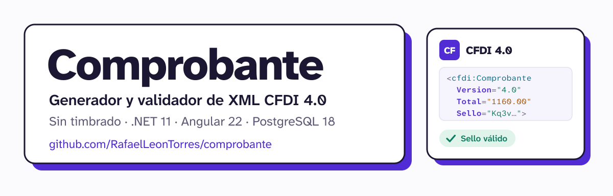
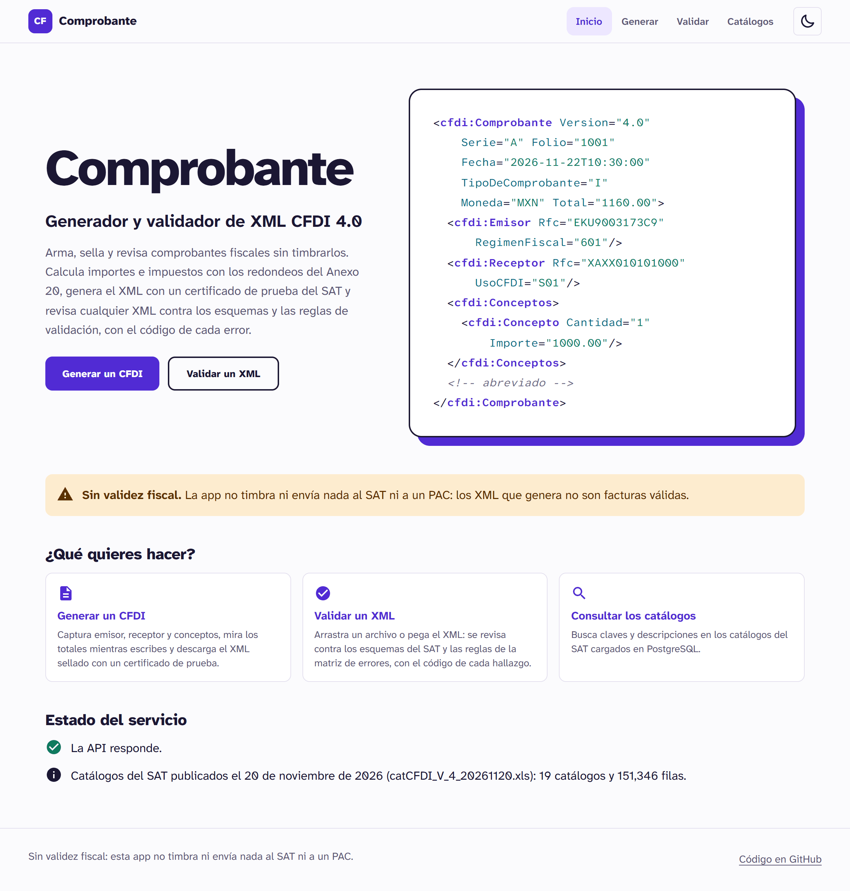
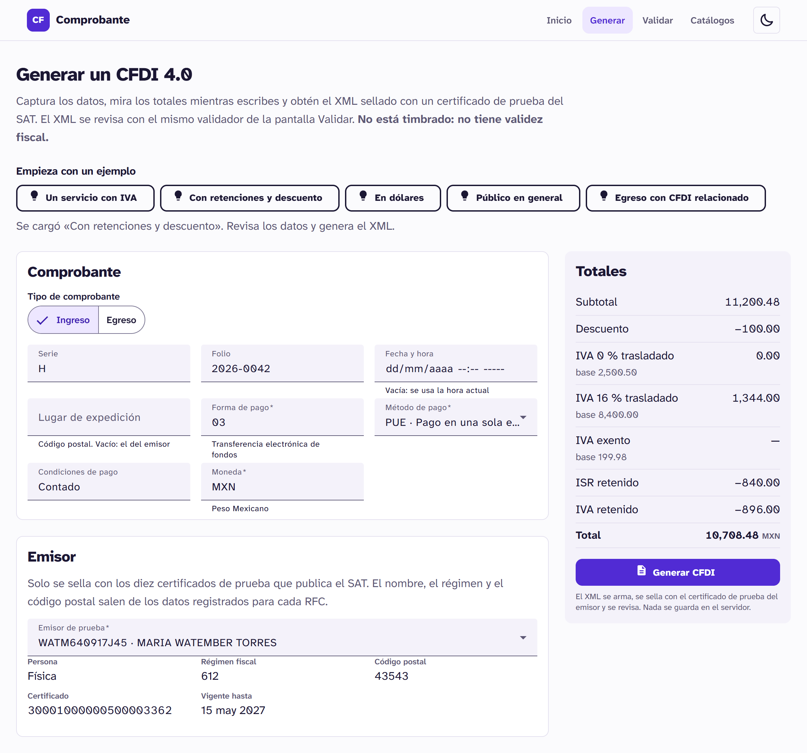
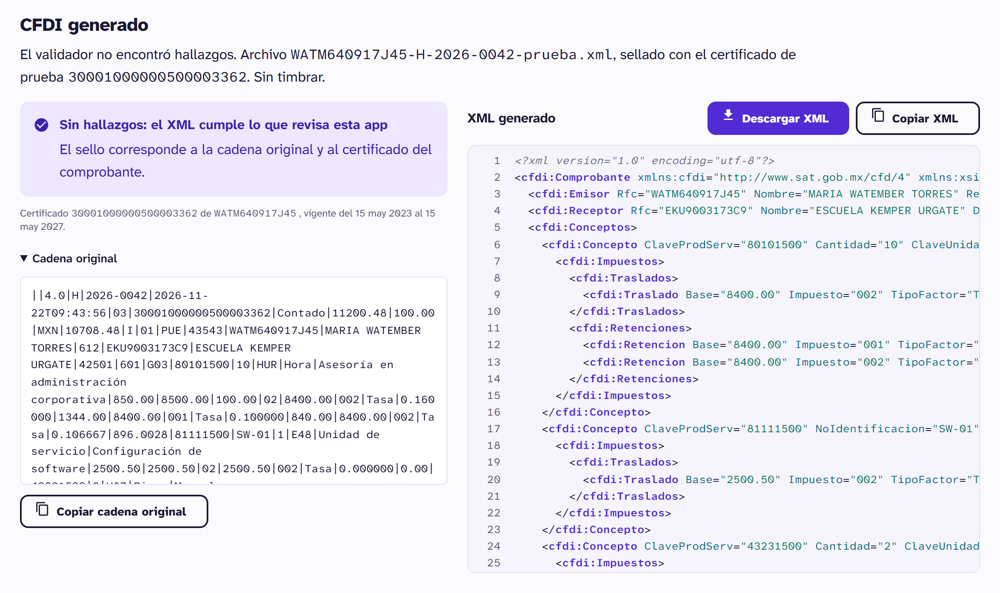
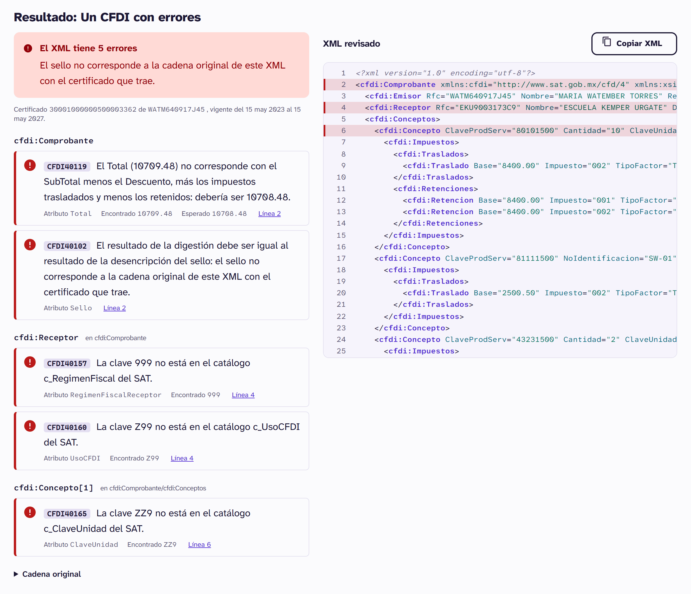
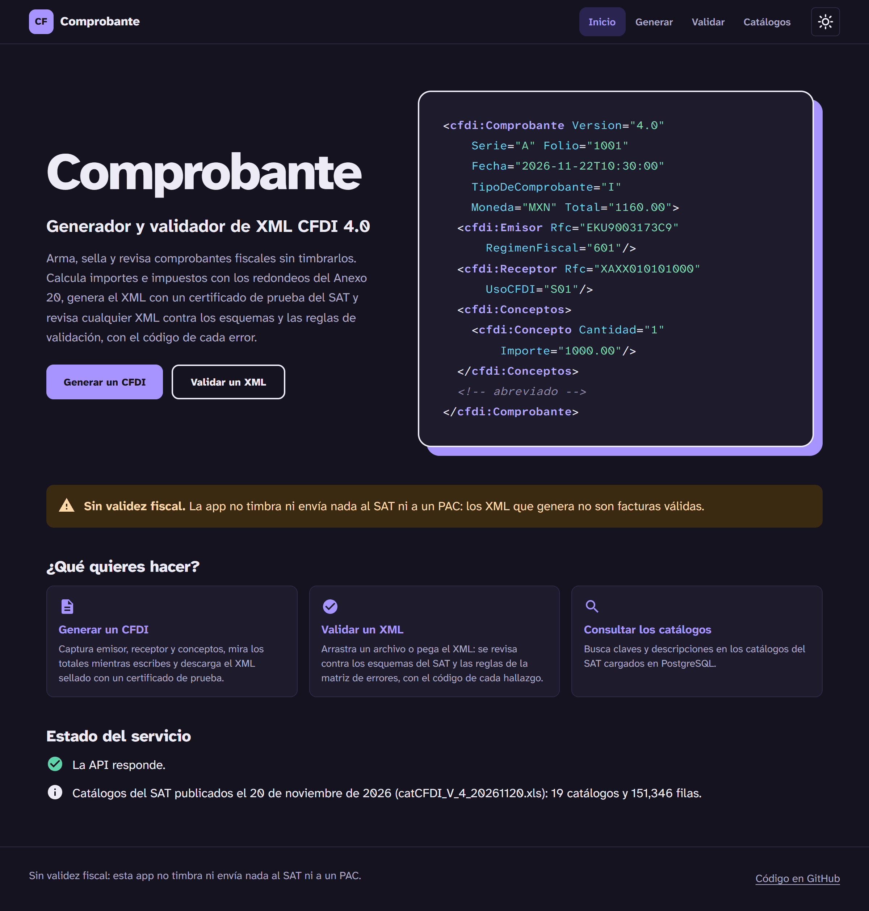
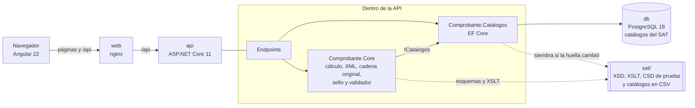

<p align="center">
  <picture>
    <source media="(prefers-color-scheme: dark)" srcset="docs/banner-oscuro.svg">
    
  </picture>
</p>

# Comprobante

[](https://github.com/RafaelLeonTorres/comprobante/actions/workflows/ci.yml)

Generador y validador de XML de **CFDI 4.0**, sin timbrado: arma el comprobante, calcula importes e impuestos con los redondeos del Anexo 20, lo sella con un certificado de prueba del SAT y revisa cualquier XML contra los esquemas oficiales y las reglas de la matriz de errores, con el código de cada hallazgo. Es la parte de la factura electrónica que no necesita a un PAC ni al SAT.

Proyecto de portafolio con **.NET 11**, **EF Core 11**, **PostgreSQL 18** y **Angular 22**, en tres contenedores de Docker. Su diseño visual es el de [mi sitio](https://rafaelleontorres.github.io/mi-sitio2/) y su estructura la de [Mediateca](https://github.com/RafaelLeonTorres/mediateca).

> **Sin validez fiscal.** La app no timbra ni envía nada al SAT ni a un PAC: los XML que genera llevan el sello de un certificado de prueba y no son facturas válidas. Lo dicen la pantalla, este README y el nombre del archivo que se descarga (`…-prueba.xml`).

## Capturas

| | |
|---|---|
| [](docs/capturas/inicio.png) | [](docs/capturas/generar.png) |
| **Inicio.** Qué hace, el aviso de que no timbra y el estado del servicio. | **Generar.** Emisor de prueba, receptor y conceptos con sus impuestos, con los totales en vivo. |
| [](docs/capturas/resultado.png) | [](docs/capturas/validar.png) |
| **Resultado.** El XML sellado con resaltado de sintaxis, su cadena original y los datos del certificado. | **Validar.** Cada hallazgo con su código del SAT, el nodo y la línea, que se marca en el XML revisado. |

La app sigue la preferencia de tu sistema (claro u oscuro) y tiene un botón para elegir; así se ve el inicio en oscuro:

[](docs/capturas/inicio-oscuro.png)

## Qué hace

- **Generar** CFDI 4.0 de ingreso y de egreso: el emisor es uno de los diez de prueba del SAT; el receptor, cualquiera, incluido «público en general» con `InformacionGlobal`; los conceptos llevan sus impuestos (IVA, IEPS, retenciones de ISR e IVA, exentos y tasa 0), descuentos, CFDI relacionados, moneda y tipo de cambio. Hay cinco ejemplos precargados.
- **Calcular** con `decimal` y los decimales de cada moneda, con los límites de redondeo del Anexo 20. Los totales se ven mientras escribes y los calcula la API: el navegador no repite las reglas.
- **Sellar** con los certificados de sello digital (CSD) de prueba que publica el SAT. La cadena original sale del XSLT oficial y el sello es RSA con SHA-256.
- **Validar** cualquier XML CFDI 4.0: los esquemas XSD del SAT, las reglas de la matriz de errores (catálogos, cálculos y relaciones entre campos) y el sello contra su certificado. Cada hallazgo trae su código (por ejemplo, `CFDI40161`), el nodo, la línea y un mensaje en español. De las 129 reglas de la matriz, 103 se revisan completas, 5 en parte y 21 no, y la app dice cuáles y por qué.
- **Catálogos del SAT** en PostgreSQL, con la fecha de su versión: 19 catálogos y 151,346 filas, con búsqueda por clave y por texto.
- **Ver y descargar** el XML con resaltado de sintaxis, junto con la cadena original, el sello y los datos del certificado.

Lo que **no** hace: timbrar, cancelar ni consultar el estatus en el SAT; comprobar que un RFC exista o que su nombre, régimen y código postal coincidan con el padrón (revisa forma y consistencia, no existencia); complementos como Pagos 2.0, Carta Porte o Nómina (un XML con complementos se valida en su parte CFDI y los complementos salen como «no revisados»); y firmar con tu propio CSD: una llave privada real no debe subir a un servidor.

## Estado

Las fases 0 a 5 están terminadas: base del proyecto, catálogos y cálculo, XML y sello, validador, la interfaz en Angular, y la seguridad y el pulido (límites de solicitudes, cabeceras y CSP, registros sin datos del usuario, tema oscuro y revisión de contraste y teclado). Falta probar la interfaz con un lector de pantalla, que lo tiene que hacer una persona. Siguen la fase 6 (descargar la representación impresa del CFDI en PDF, con una plantilla propia y logo; el boceto está en [docs/plantilla-pdf](docs/plantilla-pdf/)) y la fase 7, el cierre para el portafolio. El plan completo, con las fases, las decisiones y los criterios de aceptación, está en [PLAN.md](PLAN.md).

## Cómo está armado

Tres contenedores con Docker Compose:

| Contenedor | Qué corre | Puerto en tu equipo (por defecto) |
|---|---|---|
| `web` | nginx con el build de Angular; manda `/api` a la API | 8081 |
| `api` | API de ASP.NET Core 11; al iniciar aplica las migraciones y carga los catálogos del SAT si cambiaron | 5081, solo desde tu equipo |
| `db` | PostgreSQL 18, con los catálogos del SAT | 5435, solo desde tu equipo |

El navegador solo habla con `web`, así que la app y la API comparten origen y no hacen falta CORS ni tokens. Los puertos son distintos a los de Mediateca para poder correr los dos proyectos a la vez.



La API no guarda nada de lo que le mandas: procesa cada solicitud en memoria. La única base de datos son los catálogos públicos del SAT, que la API solo lee.

## Decisiones técnicas

- **Sin estado del usuario.** Un CFDI trae RFC, nombres y montos, así que ni el XML ni los formularios se guardan o se registran; los registros solo llevan método, ruta, resultado, duración y tamaño, sin cuerpo, parámetros ni direcciones IP. No hay cuentas ni sesiones.
- **Catálogos en PostgreSQL con EF Core.** Los 16 catálogos chicos se leen una vez y se guardan en memoria; los tres grandes (códigos postales, productos y servicios, y unidades) se consultan por clave, y la búsqueda de texto usa índices GIN `pg_trgm`. Los CSV del SAT están versionados en el repositorio y se siembran a la base al arrancar. La siembra es idempotente: compara la huella SHA-256 de los CSV con la de la última carga y, con un candado de PostgreSQL (`pg_advisory_xact_lock`) por si arrancan dos instancias a la vez, solo recarga si cambió.
- **Un núcleo sin paquetes de terceros.** `Comprobante.Core` define `ICatalogos` y no sabe de EF ni de PostgreSQL: usa `System.Xml` y `System.Security.Cryptography` y se puede usar como librería. La API y la interfaz son capas delgadas encima.
- **Los archivos del SAT, versionados.** Los XSD, el XSLT de la cadena original con sus `xsl:include`, los CSD de prueba y los catálogos viven en `sat/`, con la fecha en que se bajaron. Un `XmlResolver` propio traduce las direcciones `http://www.sat.gob.mx/sitio_internet/…` a esos archivos: no se descarga nada en tiempo de ejecución y las pruebas son reproducibles.
- **Reglas pequeñas, cada una con su código.** El validador es una lista de reglas con el código de la matriz de errores, el nodo que revisan y su mensaje en español, y cada una se prueba por separado.
- **El generador pasa por el validador.** Lo que se genera se valida antes de entregarse; si aparece un hallazgo, la respuesta lo dice en lugar de presentar el XML como correcto.
- **El cálculo vive solo en C#.** Con `decimal` y los límites del Anexo 20. Angular pide la vista previa a la API en lugar de duplicar las reglas, y el XML y el cálculo no pueden diferir.
- **Dos implementaciones, un solo resultado.** El XML sellado que produce `XmlWriter` debe ser idéntico, byte por byte, al que arma aparte una implementación en Python con lxml y OpenSSL; la cadena original de `XslCompiledTransform` se compara con la de libxslt. Como el sello PKCS#1 v1.5 es determinista, si coinciden es muy probable que ninguna tenga un error de implementación.
- **XML del usuario sin riesgos.** Se lee con `DtdProcessing.Prohibit` y sin `XmlResolver`, contra XXE y bombas de entidades; el resolver local solo se usa para los archivos del SAT.
- **Límites y cabeceras en las dos capas.** La API limita las solicitudes por IP con una ventana deslizante de un minuto (generar 20, validar 30, calcular 240, consultar 300 y 600 en total) y responde `429` con `Retry-After`; un JSON de más de 1 MiB sale con `413`. nginx pone su propio límite (20 solicitudes por segundo, con ráfaga de 60), un tope de 3 MB y las cabeceras de seguridad, con una `Content-Security-Policy` que solo admite recursos de la propia app. Los errores de nginx también salen como `problem+json`, así que la interfaz los muestra igual que los de la API.
- **Angular 22 sin Zone.js:** componentes standalone con signals, `httpResource` para leer de la API, Signal Forms en todos los formularios y rutas con carga diferida. Angular Material 3 con el tema de [mi sitio](https://rafaelleontorres.github.io/mi-sitio2/): morado .NET, Atkinson Hyperlegible y claro u oscuro. Las tipografías van dentro de la app, sin pedirlas a ningún sitio externo.
- **Accesible.** Foco visible con teclado, aviso y resultado que reciben el foco al aparecer, nombres accesibles en cada control y contraste revisado en claro y oscuro.
- **Pruebas** unitarias (xUnit), de integración contra un PostgreSQL real (Testcontainers) y de Angular (Vitest). GitHub Actions las corre en cada pull request, junto con una prueba de humo que levanta los contenedores, consulta `/api/health` a través de nginx y comprueba sus cabeceras y sus límites (CSP, `413` y `429`).

## Levantar todo por primera vez

Solo necesitas [Docker Desktop](https://www.docker.com/products/docker-desktop/) (en Linux, Docker Engine con el plugin de Compose). .NET y Node.js se usan dentro de las imágenes, así que no hace falta instalarlos para correr la app. No hay nada que configurar: todo tiene un valor por omisión que sirve en tu equipo.

1. Abre Docker Desktop y espera a que el motor esté corriendo.
2. Desde la carpeta del repositorio:

   ```bash
   docker compose up -d --build --wait
   ```

3. Abre <http://localhost:8081>.

La primera vez tarda varios minutos porque descarga las imágenes base, instala las dependencias y compila; las siguientes, Docker reutiliza lo que no cambió. Con la base vacía, los tres contenedores quedan sanos en unos 35 segundos después de compilar.

### Qué pasa en el primer arranque

1. `db` arranca y, cuando responde, `api` empieza.
2. La API crea las tablas con las migraciones de EF Core, calcula la huella de los CSV del SAT y, como la base está vacía, carga los 19 catálogos (151,346 filas, unos 15 segundos). Si la huella no cambió desde la última carga, no hace nada.
3. Cuando `api` responde en `/api/health`, arranca `web`. Por eso `docker compose ps` lo muestra unos segundos después que a los demás.

### Si algo falla

- **Un puerto está ocupado** («Ports are not available»). Cambia `WEB_PORT`, `API_PORT` o `DB_PORT` en `.env` (ver [Configuración](#configuración)) o detén lo que los usa, por ejemplo un `dotnet run` que haya quedado abierto.
- **Un contenedor no arranca.** `docker compose ps -a` muestra el estado de cada uno y `docker compose logs api` (o `web`, o `db`) el error.
- **La página dice que la API no responde.** Revisa `docker compose ps`: si `api` sigue en «starting», está cargando los catálogos y basta esperar unos segundos.
- **Cambiaste `POSTGRES_PASSWORD` después del primer arranque.** La contraseña se fija cuando se crea el volumen de la base. Ejecuta `docker compose down -v` para empezar de cero; se borran los catálogos cargados, que la API vuelve a sembrar al arrancar.

## Uso diario

| Para | Comando |
|---|---|
| Levantar sin recompilar | `docker compose up -d` |
| Recompilar después de cambiar el código | `docker compose up -d --build --wait` |
| Recompilar sola cada vez que guardas | `docker compose watch` |
| Ver el estado | `docker compose ps` |
| Ver el log de la API | `docker compose logs -f api` |
| Detener (los catálogos se quedan en el volumen) | `docker compose down` |
| Empezar de cero (borra la base) | `docker compose down -v` |

## Configuración

Es opcional. Para cambiar algo, copia `.env.example` como `.env` (no se sube a git):

| Variable | Para qué | Por omisión |
|---|---|---|
| `POSTGRES_PASSWORD` | Contraseña de PostgreSQL. Se fija al crear la base | `comprobante-dev` |
| `WEB_PORT` | Puerto de la app | `8081` |
| `API_PORT` | Puerto de la API y de su documentación (`/api/scalar`), solo desde tu equipo | `5081` |
| `DB_PORT` | Puerto de PostgreSQL, solo desde tu equipo | `5435` |
| `TZ` | Zona horaria del contenedor de la API | `America/Mexico_City` |
| `API_ENVIRONMENT` | Entorno de ASP.NET Core | `Production` |

La base solo acepta conexiones de tu equipo y guarda catálogos públicos del SAT; si publicas la app, pon una contraseña propia. Los archivos de `sat/` que usa la API (catálogos, esquemas, XSLT y CSD de prueba) viajan dentro de sus ensamblados, así que no hay rutas que configurar.

## API

Todo vive bajo `/api`, así nginx lo pasa con una sola regla. La descripción OpenAPI está en `/api/openapi/v1.json` y la página para probar la API, en `/api/scalar` (en <http://localhost:5081/api/scalar> con los puertos por omisión).

| Método y ruta | Para qué |
|---|---|
| `GET /api/health` | Saber si la API responde |
| `GET /api/emisores-prueba` | Los emisores de los CSD de prueba: RFC, nombre, régimen y código postal |
| `POST /api/comprobantes/calculo` | Vista previa: recibe el comprobante en JSON y devuelve importes, impuestos y totales, con los errores de entrada por campo |
| `POST /api/comprobantes` | Genera y sella con el emisor de prueba elegido: `{ xml, cadenaOriginal, sello, noCertificado, calculo, validacion }` |
| `POST /api/validaciones` | Recibe el XML en el cuerpo (`application/xml` o `text/xml`, hasta 2 MB) y devuelve el reporte: `{ esValido, hallazgos, selloValido, cadenaOriginal, certificado }`. Un XML con errores es un 200 con sus hallazgos, no un error de la solicitud |
| `GET /api/validaciones/reglas` | Las 129 reglas de la matriz de errores y lo que la app hace con cada una (`revisada`, `parcial` o `noRevisada`, con su motivo) |
| `GET /api/catalogos` y `GET /api/catalogos/{nombre}?q=&pagina=&tamano=` | Versión y tamaño de los catálogos, y búsqueda paginada de claves |

Los errores son `ProblemDetails` en español: 400 con los errores por campo, 413 si el XML (más de 2 MB) o el JSON (más de 1 MiB) pasan del límite, 415 si no es XML y 429 si se pasa el límite de solicitudes por minuto (la respuesta trae `Retry-After`). Por ejemplo, para validar un XML desde la terminal:

```bash
curl -X POST http://localhost:8081/api/validaciones \
  -H "Content-Type: application/xml" \
  --data-binary @mi-comprobante.xml
```

## Los archivos del SAT

Los catálogos cambian varias veces al año, así que actualizarlos es un procedimiento, no un cambio de código. Desde la raíz del repositorio, en PowerShell (necesita el SDK de .NET 11):

```powershell
# 1. Bajar los archivos oficiales a sat/ (esquemas y XSLT) y a sat/origen/ (el Excel; no va a git).
#    El nombre del Excel cambia con cada publicación: se ve en
#    http://omawww.sat.gob.mx/tramitesyservicios/Paginas/anexo_20.htm
powershell -NoProfile -ExecutionPolicy Bypass -File sat\descargar.ps1 -Catalogos catCFDI_V_4_AAAAMMDD.xls

# 2. Convertir el Excel en un CSV por catálogo y un version.json con la fecha de publicación.
dotnet run --project backend/src/Comprobante.Herramientas -- importar-catalogos sat/origen/catCFDI_V_4_AAAAMMDD.xls sat/catalogos

# 3. Correr las pruebas: comprueban que los 19 catálogos carguen y que las reglas sigan cuadrando.
dotnet test backend/Comprobante.slnx

# 4. Subir el cambio con la fecha de la versión. El diff de los CSV muestra qué cambió.
git add sat && git commit -m "Catálogos del SAT: versión AAAA-MM-DD"
```

Al arrancar, la API detecta que la huella de los CSV cambió y recarga las tablas sola; la versión nueva se ve en el inicio de la app y en `GET /api/catalogos`. La matriz de errores se actualiza igual, con `importar-matriz` y `sat/matriz`.

### Certificados de prueba

El SAT publica diez CSD de prueba. Sus llaves y su contraseña son públicas (`12345678a`) y no valen ante el SAT: solo sirven para firmar comprobantes de ejemplo, y Comprobante no firma con ningún otro. Están en `sat/csd-prueba/` (ver su [LEEME](sat/csd-prueba/LEEME.md)) y **vencen en mayo de 2027**. Cuando el SAT publique unos nuevos, `sat/descargar.ps1` baja el zip a `sat/origen/` y se vuelve a elegir la selección.

### Archivos de referencia de las pruebas

Los XML sellados y las cadenas originales esperadas de `backend/tests/Comprobante.UnitTests/Referencia/` los produce un script aparte, con lxml y OpenSSL. Para agregar un escenario o cuando cambian los esquemas, el XSLT o los certificados:

```bash
python3 backend/tests/Comprobante.UnitTests/Referencia/generar_referencia.py
```

Hace falta Python 3 con `lxml` y `cryptography`. Más en su [LEEME](backend/tests/Comprobante.UnitTests/Referencia/LEEME.md).

## Seguridad

- El XML se lee con `DtdProcessing.Prohibit` y sin `XmlResolver`: sin XXE ni bombas de entidades, con un tamaño máximo de 2 MB.
- No se guarda ni se registra el contenido de ningún XML ni de ningún formulario. Los registros llevan método, ruta, estado, duración y tamaño; no llevan cuerpo, parámetros ni direcciones IP.
- Solo se firma con los CSD de prueba del SAT, que son públicos. La API nunca recibe llaves privadas.
- Límites por IP: la API responde `429` (con `Retry-After`) al pasarse de las solicitudes por minuto de cada operación y `413` si el cuerpo es demasiado grande; nginx pone un límite general y un tope de 3 MB. Los dos devuelven `ProblemDetails` en español.
- nginx manda `Content-Security-Policy` (scripts, tipografías, imágenes y conexiones solo de la propia app, sin objetos ni marcos), `X-Content-Type-Options`, `Referrer-Policy`, `X-Frame-Options`, `Permissions-Policy`, `Cross-Origin-Opener-Policy` y `Cross-Origin-Resource-Policy`; la API no anuncia su servidor. La CI comprueba las cabeceras y los límites contra los contenedores.
- La API se explica sola con OpenAPI y Scalar, también en producción: no tiene nada privado.

## Desarrollo

Para trabajar sin recompilar los contenedores en cada cambio, deja corriendo solo la base y corre la API y la app aparte. Necesitas el SDK de .NET 11 (la versión está en `global.json`) y Node.js 24.

```powershell
docker compose up -d db                                   # PostgreSQL en el puerto 5435
dotnet run --project backend/src/Comprobante.Api          # la API siembra los catálogos al iniciar
cd frontend; npm install; npm start                       # la app en http://localhost:4200
```

`npm start` manda `/api` a la API con `proxy.conf.json`, así que no hace falta CORS. Con `dotnet run`, la API usa la cadena de conexión de `appsettings.json`, que apunta a la base de Docker de este mismo repositorio.

Las capturas de este README las toma `node docs/capturas/tomar-capturas.mjs`, con Edge o Chrome sin interfaz, contra la app corriendo en <http://localhost:8081>. Más en su [LEEME](docs/capturas/LEEME.md).

## Pruebas

| Qué | Comando | Cuántas |
|---|---|---|
| Backend: unitarias (xUnit) | `dotnet test backend/Comprobante.slnx` | 355 |
| Backend: integración con un PostgreSQL desechable (Testcontainers; necesita Docker) | `dotnet test backend/Comprobante.slnx` | 67 |
| Frontend (Vitest) | `cd frontend; npx ng test --watch=false` | 215 |

Las pruebas de integración levantan la API contra un PostgreSQL 18 real y comprueban, entre otras cosas, que lo que se genera pasa la validación sin hallazgos, que un XML con errores sembrados devuelve sus códigos, que un XML con XXE se rechaza y que los límites de solicitudes y de tamaño responden `429` y `413`. GitHub Actions corre todo en cada pull request y en cada push a `main`.

## Estructura

```text
Comprobante/
├── PLAN.md                         el plan: alcance, fases, decisiones y criterios de aceptación
├── docker-compose.yml              web, api y db
├── .env.example                    puertos y contraseña de la base
├── .github/workflows/ci.yml        pruebas y prueba de humo con Docker en cada pull request
├── docs/                           el banner, las capturas de este README (y el script que las toma) y el boceto de la plantilla del PDF
├── sat/
│   ├── descargar.ps1 y fuentes.json   de dónde sale cada archivo, cuándo se bajó y su huella
│   ├── esquemas/                   cfdv40.xsd, catCFDI.xsd, tdCFDI.xsd y el del Timbre Fiscal Digital
│   ├── xslt/                       cadenaoriginal_4_0.xslt y los XSLT que incluye
│   ├── csd-prueba/                 .cer, .key y emisores.json de los diez CSD de prueba (públicos)
│   ├── catalogos/                  un CSV por catálogo y version.json con la fecha de publicación
│   └── matriz/                     matriz-errores.csv: las 129 reglas con su código y su mensaje
├── backend/
│   ├── Dockerfile
│   ├── Comprobante.slnx
│   ├── src/
│   │   ├── Comprobante.Core/           solicitud, cálculo y redondeo, XML, cadena original, sello y validador
│   │   ├── Comprobante.Catalogos/      EF Core: modelo, migraciones, siembra y consultas
│   │   ├── Comprobante.Herramientas/   importador del Excel del SAT (consola)
│   │   └── Comprobante.Api/            endpoints, errores en español, límites de solicitudes y OpenAPI
│   └── tests/
│       ├── Comprobante.UnitTests/          incluye Referencia/: XML y cadenas hechos con Python, lxml y OpenSSL
│       └── Comprobante.IntegrationTests/   la API contra un PostgreSQL desechable
└── frontend/                       Angular 22: generar, validar y consultar los catálogos
    ├── Dockerfile
    ├── nginx.conf                  /api, límites, CSP y registro de accesos sin datos del usuario
    └── nginx-cabeceras.conf        las cabeceras de seguridad, que comparten todas las rutas
```

## Licencia

[MIT](LICENSE)
